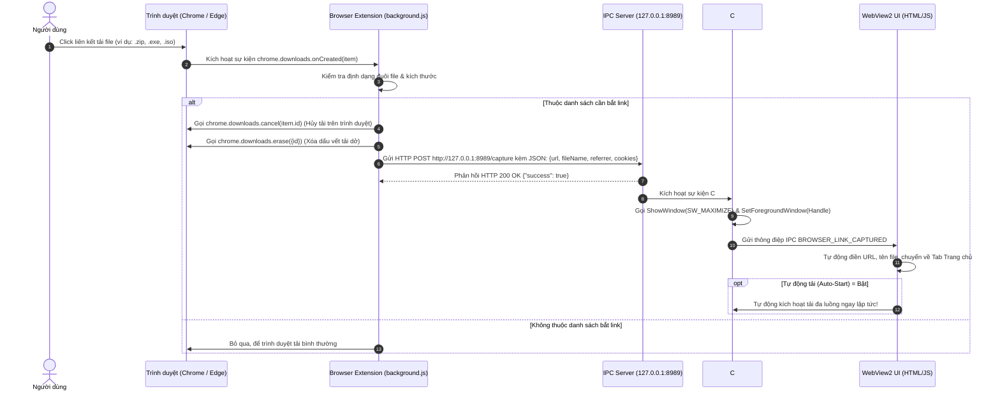
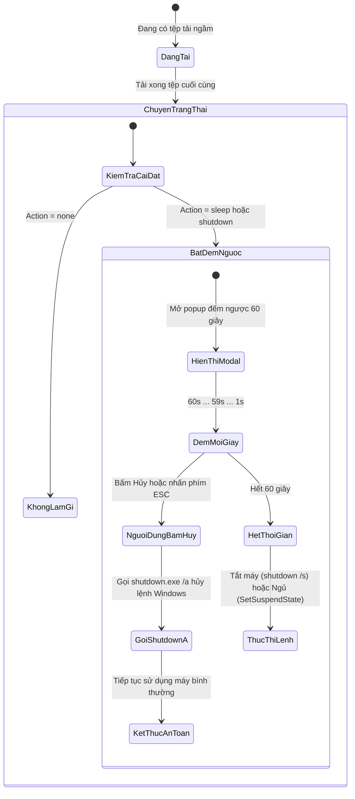

# TÀI LIỆU KỸ THUẬT: CƠ CHẾ HOẠT ĐỘNG CÁC TÍNH NĂNG MỞ RỘNG
### Đề tài PBL4: Ứng dụng Tăng tốc Tải tệp (DUT Download Accelerator)
**Bộ môn: Hệ điều hành & Mạng máy tính — Khoa Công nghệ Thông tin, Trường Đại học Bách Khoa - ĐHĐN**

---

## MỤC LỤC
1. [TỔNG QUAN & BẢNG ÁNH XẠ FILE CHƯƠNG TRÌNH](#1-tổng-quan--bảng-ánh-xạ-file-chương-trình)
2. [TÍNH NĂNG 1: BẮT LINK TỰ ĐỘNG TỪ TRÌNH DUYỆT (BROWSER EXTENSION & IPC SERVER)](#2-tính-năng-1-bắt-link-tự-động-từ-trình-duyệt-browser-extension--ipc-server)
   - 2.1 Bản chất Kỹ thuật & Giao tiếp Liên tiến trình (IPC)
   - 2.2 Luồng Hoạt động từ Extension tới Desktop App (Sequence Diagram)
   - 2.3 Bảo mật CORS & Kỹ thuật Kích hoạt Cửa sổ Win32 (Maximize & Foreground)
   - 2.4 File Chương trình & Phân tích Mã nguồn (`BrowserExtensionServer.cs`, `background.js`)
3. [TÍNH NĂNG 2: LẬP LỊCH TẢI VỀ TỰ ĐỘNG (DOWNLOAD SCHEDULER)](#3-tính-năng-2-lập-lịch-tải-về-tự-động-download-scheduler)
   - 3.1 Nguyên lý Đồng hồ Thời gian thực & Kích hoạt Hàng đợi
   - 3.2 Bộ đếm giờ Không Block (`System.Threading.Timer`)
   - 3.3 File Chương trình & Phân tích Mã nguồn (`DownloadScheduler.cs`)
4. [TÍNH NĂNG 3: QUẢN LÝ NGUỒN ĐIỆN WINDOWS & CHỐNG RU NGỦ KHI TẢI (POWER MANAGEMENT)](#4-tính-năng-3-quản-lý-nguồn-điện-windows--chống-ru-ngủ-khi-tải-power-management)
   - 4.1 Cơ chế Ngăn Chế độ Ngủ qua Win32 API (`SetThreadExecutionState`)
   - 4.2 Tự động Ngủ (`SetSuspendState`) & Tắt máy (`shutdown.exe /s /t`)
   - 4.3 Đồng hồ Đếm ngược Hủy Lệnh An toàn (ESC / Cancel via `shutdown /a`)
   - 4.4 File Chương trình & Phân tích Mã nguồn (`PowerManagementHelper.cs`)
5. [TÍNH NĂNG 4: THÔNG BÁO HỆ THỐNG & KHAY HỆ THỐNG (SYSTEM TRAY & NOTIFICATIONS)](#5-tính-năng-4-thông-báo-hệ-thống--khay-hệ-thống-system-tray--notifications)
   - 5.1 Thu nhỏ vào Khay Hệ thống khi Bấm Đóng (Minimize to Tray on Close)
   - 5.2 Windows BalloonTip & Tương tác Mở File Tức thì
   - 5.3 Menu Ngữ cảnh System Tray Đa Ngôn ngữ (i18n ContextMenu)
   - 5.4 File Chương trình & Phân tích Mã nguồn (`Form1.cs`)
6. [TÍNH NĂNG 5: KIỂM TRA MÃ BĂM TỆP (CHECKSUM MD5 & SHA-256)](#6-tính-năng-5-kiểm-tra-mã-băm-tệp-checksum-md5--sha-256)
   - 6.1 Bản chất Toán học Mật mã & Kiểm tra Toàn vẹn Dữ liệu
   - 6.2 Tính toán Băm Không Tràn RAM qua FileStream
   - 6.3 Giao diện So khớp Mã băm Mẫu (Expected Hash Matching)
   - 6.4 File Chương trình & Phân tích Mã nguồn (`ChecksumHelper.cs`)
7. [TÍNH NĂNG 6: TỰ ĐỘNG QUÉT MÃ ĐỘC VỚI MICROSOFT DEFENDER ANTIVIRUS](#7-tính-năng-6-tự-động-quét-mã-độc-với-microsoft-defender-antivirus)
   - 7.1 Tích hợp Công cụ Dòng lệnh `MpCmdRun.exe`
   - 7.2 Thuật toán Dò tìm Đường dẫn Windows Defender trên Windows 10/11
   - 7.3 Xử lý Mã Thoát (Exit Codes) & Cảnh báo An toàn Người dùng
   - 7.4 File Chương trình & Phân tích Mã nguồn (`AntivirusScanner.cs`)
8. [TÍNH NĂNG 7: TẢI HÀNG LOẠT & SINH URL THEO QUY LUẬT (BATCH DOWNLOAD & PATTERN EXPANSION)](#8-tính-năng-7-tải-hàng-loạt--sinh-url-theo-quy-luật-batch-download--pattern-expansion)
   - 8.1 Cú pháp Quy luật URL (Số nguyên đệm 0, Chữ cái, Danh sách)
   - 8.2 Thuật toán Tích Descartes Mở rộng Nhiều Quy luật Lồng nhau
   - 8.3 Nhập Tự động từ Tệp `.txt` / `.csv`
   - 8.4 File Chương trình & Phân tích Mã nguồn (`UrlPatternExpander.cs`)
9. [TÍNH NĂNG 8: TẢI TỆP QUA GIAO THỨC FTP (FTP DOWNLOAD ENGINE)](#9-tính-năng-8-tải-tệp-qua-giao-thức-ftp-ftp-download-engine)
   - 9.1 Giao thức FTP Chuẩn (RFC 959) & So sánh với HTTP
   - 9.2 Lệnh `SIZE` & Lệnh `REST` (Restart Marker) Phục vụ Resume FTP
   - 9.3 File Chương trình & Phân tích Mã nguồn (`FtpProbe.cs`, `FtpJob.cs`)
10. [TÍNH NĂNG 9: GIÁM SÁT HIỆU NĂNG HỆ THỐNG THỜI GIAN THỰC (SYSTEM MONITORING & CHARTS)](#10-tính-năng-9-giám-sát-hiệu-năng-hệ-thống-thời-gian-thực-system-monitoring--charts)
    - 10.1 Đo đạc CPU & RAM qua Windows `PerformanceCounter`
    - 10.2 Đo Tốc độ Tức thời & Ước lượng Thời gian Hoàn tất (ETA)
    - 10.3 Vẽ Biểu đồ Sóng Thời gian thực (Chart.js)
11. [BỘ CÂU HỎI VẤN ĐÁP KỸ THUẬT BẢO VỆ ĐỀ TÀI PHẦN MỞ RỘNG](#11-bộ-câu-hỏi-vấn-đáp-kỹ-thuật-bảo-vệ-đề-tài-phần-mở-rộng)

---

## 1. TỔNG QUAN & BẢNG ÁNH XẠ FILE CHƯƠNG TRÌNH

Dưới đây là bảng tổng hợp các file nguồn C#, JavaScript và Extension đảm nhiệm các tính năng mở rộng của ứng dụng:

| Chức Năng | File Mã Nguồn | Lớp / Module Cốt Lõi | Nhiệm Vụ Kỹ Thuật Đảm Nhiệm |
| :--- | :--- | :--- | :--- |
| **Bắt link Trình duyệt** | [`BrowserExtensionServer.cs`](file:///c:/PBL4/WindowsFormsApp/IPC/BrowserExtensionServer.cs)<br>[`background.js`](file:///c:/PBL4/BrowserExtension/background.js) | `BrowserExtensionServer`, Chrome Extension Service Worker | Máy chủ HTTP Loopback nội bộ `127.0.0.1:8989`, bắt sự kiện `chrome.downloads.onCreated`, hủy tải trên trình duyệt và chuyển về Desktop App. |
| **Kích hoạt Win32** | [`Form1.cs`](file:///c:/PBL4/WindowsFormsApp/Form1.cs)<br>[`Program.cs`](file:///c:/PBL4/WindowsFormsApp/Program.cs) | `Form1`, Win32 User32 API | Single-Instance Mutex `Global\DUT...`, gọi `ShowWindow(SW_MAXIMIZE)` và `SetForegroundWindow` để tự động bật và phóng to toàn màn hình khi bắt link. |
| **Lập lịch Tải về** | [`DownloadScheduler.cs`](file:///c:/PBL4/WindowsFormsApp/Download/DownloadScheduler.cs) | `DownloadScheduler`, `ScheduleSettings` | Quản lý đồng hồ kiểm tra giờ thực tế bằng `System.Threading.Timer`, tự động kích hoạt hàng đợi tải khi tới giờ hẹn (ví dụ: 22:00). |
| **Quản lý Nguồn điện** | [`PowerManagementHelper.cs`](file:///c:/PBL4/WindowsFormsApp/Download/PowerManagementHelper.cs) | `PowerManagementHelper`, Win32 Kernel32/Powrprof | Gọi `SetThreadExecutionState` chống Windows rơi vào Sleep khi đang tải ngầm; tự động Sleep (`SetSuspendState`) hoặc Shutdown (`shutdown.exe /s /t 60`). |
| **System Tray & Thông báo** | [`Form1.cs`](file:///c:/PBL4/WindowsFormsApp/Form1.cs) | `NotifyIcon`, `ContextMenuStrip` | Ẩn xuống khay hệ thống khi bấm nút đóng `[X]`, hiện Windows BalloonTip Toast khi tải xong, bấm vào thông báo để mở file ngay lập tức. |
| **Kiểm tra Mã băm** | [`ChecksumHelper.cs`](file:///c:/PBL4/WindowsFormsApp/Download/ChecksumHelper.cs) | `ChecksumHelper` | Tính toán mã băm SHA-256 và MD5 qua `FileStream` tối ưu, hỗ trợ so khớp mã băm mẫu cung cấp từ website. |
| **Quét Virus Defender** | [`AntivirusScanner.cs`](file:///c:/PBL4/WindowsFormsApp/Download/AntivirusScanner.cs) | `AntivirusScanner` | Tự động dò tìm công cụ dòng lệnh `MpCmdRun.exe` trên Windows 10/11, quét file tải về và hiển thị kết quả an toàn / cảnh báo mã độc. |
| **Tải URL theo Quy luật** | [`UrlPatternExpander.cs`](file:///c:/PBL4/WindowsFormsApp/Download/UrlPatternExpander.cs) | `UrlPatternExpander` | Phân tích quy luật `[01-10]`, `[a-z]`, tính tích Descartes mở rộng nhiều quy luật lồng nhau, đọc danh sách từ file `.txt`/`.csv`. |
| **Tải tệp FTP** | [`FtpProbe.cs`](file:///c:/PBL4/WindowsFormsApp/Download/FtpProbe.cs)<br>[`FtpJob.cs`](file:///c:/PBL4/WindowsFormsApp/Download/FtpJob.cs) | `FtpProbe`, `FtpJob` | Thăm dò kích thước qua lệnh FTP `SIZE`, tải từng phần qua lệnh `REST` (Restart marker), hỗ trợ tiếp tục tải (Resume FTP). |
| **Giám sát Hiệu năng** | [`MessageHandler.cs`](file:///c:/PBL4/WindowsFormsApp/IPC/MessageHandler.cs)<br>[`chart-monitor.js`](file:///c:/PBL4/WindowsFormsApp/public/js/chart-monitor.js) | `PerformanceCounter`, Chart.js | Thu thập mức chiếm dụng CPU, RAM của ứng dụng và vẽ biểu đồ sóng trực quan thời gian thực. |

---

## 2. TÍNH NĂNG 1: BẮT LINK TỰ ĐỘNG TỪ TRÌNH DUYỆT (BROWSER EXTENSION & IPC SERVER)

### 2.1 Bản chất Kỹ thuật & Giao tiếp Liên tiến trình (IPC)
Trong kiến trúc phần mềm máy tính, một tiện ích mở rộng chạy bên trong Sandbox của trình duyệt (Chrome/Edge) **không thể trực tiếp gọi hàm hoặc can thiệp vào bộ nhớ của một tiến trình Windows Forms bên ngoài**.
* Để giải quyết bài toán giao tiếp liên tiến trình (**Inter-Process Communication - IPC**), ứng dụng DUT Download Accelerator biến chính nó thành một **Máy chủ Web HTTP Loopback siêu nhẹ (Local Loopback Server)**.
* Máy chủ này lắng nghe trên địa chỉ cục bộ an toàn: **`http://127.0.0.1:8989/`**.
* Địa chỉ IP `127.0.0.1` (localhost) là giao diện mạng ảo (Loopback Network Interface) của hệ điều hành, các gói tin TCP chỉ luân chuyển nội bộ trong bộ nhớ RAM của máy tính mà không bao giờ phát ra card mạng vật lý, đảm bảo tốc độ truyền gần như tức thì (< 1ms).

### 2.2 Luồng Hoạt động từ Extension tới Desktop App (Sequence Diagram)



### 2.3 Bảo mật CORS & Kỹ thuật Kích hoạt Cửa sổ Win32 (Maximize & Foreground)

#### 1. Cơ chế Bảo mật Chống Website Độc hại (CORS White-listing)
Vì máy chủ HTTP chạy trên cổng `8989` nội bộ, nếu không có cơ chế bảo vệ, một trang web độc hại bất kỳ trên Internet có thể chạy mã JavaScript gửi request ngầm đến `http://127.0.0.1:8989/capture` để bắt ứng dụng tải virus về máy người dùng.
* **Giải pháp trong [`BrowserExtensionServer.cs`](file:///c:/PBL4/WindowsFormsApp/IPC/BrowserExtensionServer.cs) (dòng 79-98):**
```csharp
// Kiểm tra Header Origin của request gửi tới
string origin = req.Headers["Origin"];
bool isExtension = !string.IsNullOrEmpty(origin) && 
                   (origin.StartsWith("chrome-extension://", StringComparison.OrdinalIgnoreCase) ||
                    origin.StartsWith("edge-extension://", StringComparison.OrdinalIgnoreCase) ||
                    origin.StartsWith("moz-extension://", StringComparison.OrdinalIgnoreCase));

bool isLocalhost = string.IsNullOrEmpty(origin) || 
                   origin.Contains("localhost") || 
                   origin.Contains("127.0.0.1");

// NẾU KHÔNG PHẢI EXTENSION HOẶC NỘI BỘ -> CHẶN ĐỨNG NGAY LẬP TỨC!
if (!isExtension && !isLocalhost)
{
    res.StatusCode = 403; // Forbidden
    res.Close();
    return;
}
```

#### 2. Kỹ thuật Kích hoạt & Phóng to Cửa sổ Toàn màn hình qua Win32 API
Khi trình duyệt bắt được link tải, ứng dụng Desktop có thể đang bị thu nhỏ (Minimized) hoặc ẩn dưới khay hệ thống. Để cửa sổ ứng dụng lập tức hiện lên nổi bật và mở rộng toàn màn hình:
* Sử dụng các API của thư viện `user32.dll`:
  * `ShowWindow(Handle, SW_MAXIMIZE)` với hằng số `SW_MAXIMIZE = 3`.
  * `SetForegroundWindow(Handle)` để giành quyền ưu tiên hiển thị trước các cửa sổ khác của Windows.

### 2.4 File Chương trình & Phân tích Mã nguồn

#### 1. Phía Browser Extension: [`BrowserExtension/background.js`](file:///c:/PBL4/BrowserExtension/background.js)
```javascript
// Bắt sự kiện tải tệp từ trình duyệt
chrome.downloads.onCreated.addListener(async (downloadItem) => {
    // 1. Kiểm tra trạng thái bật/tắt của Extension
    const config = await getStoredConfig();
    if (!config.enabled) return;

    // 2. Kiểm tra phần mở rộng tệp tin (Extensions filter: zip, iso, rar, mp4, exe...)
    const url = downloadItem.finalUrl || downloadItem.url;
    if (!shouldIntercept(url, downloadItem.filename)) return;

    // 3. Ngắt tiến trình tải của trình duyệt
    chrome.downloads.cancel(downloadItem.id, () => {
        chrome.downloads.erase({ id: downloadItem.id });
    });

    // 4. Đóng gói dữ liệu gửi sang Desktop App qua HTTP Loopback
    const payload = {
        url: url,
        fileName: getFileName(downloadItem),
        referrer: downloadItem.referrer || "",
        totalBytes: downloadItem.fileSize > 0 ? downloadItem.fileSize : 0,
        autoStart: config.autoStart
    };

    fetch("http://127.0.0.1:8989/capture", {
        method: "POST",
        headers: { "Content-Type": "application/json" },
        body: JSON.stringify(payload)
    }).catch(err => {
        console.warn("Không kết nối được với DUT Download Accelerator Desktop:", err);
    });
});
```

#### 2. Phía C# Desktop App: [`WindowsFormsApp/Form1.cs`](file:///c:/PBL4/WindowsFormsApp/Form1.cs)
```csharp
private void OnBrowserLinkCaptured(CapturedLinkDto link)
{
    // Yêu cầu: Bật lên và phóng to toàn màn hình ngay khi bắt link từ extension
    BringToFrontAndRestore(maximize: true);

    if (link == null || string.IsNullOrWhiteSpace(link.Url)) return;

    // Gửi thông điệp sang WebView2 để điền form
    var payload = new
    {
        action = "BROWSER_LINK_CAPTURED",
        data = link,
        defaultSavePath = SettingsManager.Current?.DefaultSavePath
    };
    SendToWeb(JsonSerializer.Serialize(payload, CamelCaseJsonOptions));
}
```

---

## 3. TÍNH NĂNG 2: LẬP LỊCH TẢI VỀ TỰ ĐỘNG (DOWNLOAD SCHEDULER)

### 3.1 Nguyên lý Đồng hồ Thời gian thực & Kích hoạt Hàng đợi
Trong thực tế sử dụng, người dùng thường có nhu cầu: *"Tôi muốn thêm 10 bộ phim vào hàng đợi, nhưng máy tính chỉ được bắt đầu tải lúc 01:00 AM đêm để không làm chậm mạng khi gia đình đang sử dụng"*.

* **Bản chất kỹ thuật:** Lớp [`DownloadScheduler.cs`](file:///c:/PBL4/WindowsFormsApp/Download/DownloadScheduler.cs) khởi tạo một đồng hồ nhịp tim (Heartbeat Timer).
* Cứ mỗi **1000 mili-giây (1 giây)**, hàm `OnScheduleCheck` sẽ thức dậy, so sánh giờ và phút hiện tại của hệ điều hành (`DateTime.Now.ToString("HH:mm")`) với mốc thời gian người dùng đã cài đặt (`StartTime`, ví dụ `"01:00"`).
* **Nguyên tắc Chống Kích hoạt Trùng lặp (Debounce / Trigger Lock):** Để tránh việc trong suốt 60 giây của phút `01:00` hàm timer bắn tín hiệu 60 lần, ứng dụng lưu khóa `_lastTriggerKey = "2026-11-08_01:00"`. Trong cùng một ngày và cùng một phút, sự kiện chỉ được phát đúng **1 lần duy nhất**.

### 3.2 Bộ đếm giờ Không Block (`System.Threading.Timer`)
* Ứng dụng **tuyệt đối không dùng `Thread.Sleep` hay vòng lặp `while(true)`** vì sẽ làm treo giao diện người dùng (Freeze UI).
* Thay vào đó, ứng dụng sử dụng **`System.Threading.Timer`**: một cơ chế ngắt bộ đếm giờ chạy trên luồng phụ thuộc ThreadPool của Windows. Khi chưa đến giờ, luồng này ở trạng thái ngủ hoàn toàn (Dormant State), tiêu thụ $0\%$ CPU.

### 3.3 File Chương trình & Phân tích Mã nguồn (`DownloadScheduler.cs`)

```csharp
// Trích từ WindowsFormsApp/Download/DownloadScheduler.cs (dòng 145-180)
private void OnScheduleCheck(object state)
{
    lock (_lock)
    {
        if (_settings == null || !_settings.Enabled) return;

        DateTime now = DateTime.Now;
        string currentHm = now.ToString("HH:mm");

        // Kiểm tra xem giờ hiện tại có trùng với giờ đã hẹn hay không
        if (string.Equals(currentHm, _settings.StartTime, StringComparison.OrdinalIgnoreCase))
        {
            string todayKey = now.ToString("yyyy-MM-dd_") + currentHm;
            if (_lastTriggerKey == todayKey) return; // Đã kích hoạt trong phút này rồi -> bỏ qua

            _lastTriggerKey = todayKey;
            Debug.WriteLine($"[Scheduler] Đúng khung giờ đã hẹn ({currentHm}): Kích hoạt hàng đợi tải!");

            // Bắn sự kiện ra ngoài cho DownloadManager kích hoạt toàn bộ task
            try
            {
                SchedulerTriggered?.Invoke();
            }
            catch (Exception ex)
            {
                Debug.WriteLine("[Scheduler] Trigger error: " + ex.Message);
            }
        }
    }
}
```

Khi sự kiện `SchedulerTriggered` phát ra, lớp [`MessageHandler.cs`](file:///c:/PBL4/WindowsFormsApp/IPC/MessageHandler.cs) sẽ gọi lệnh:
```csharp
_downloadManager.StartAllQueuedOrPausedDownloads();
```
Toàn bộ các tệp tin đang xếp hàng chờ hoặc đang tạm dừng sẽ đồng loạt chuyển sang trạng thái bắt đầu tải!

---

## 4. TÍNH NĂNG 3: QUẢN LÝ NGUỒN ĐIỆN WINDOWS & CHỐNG RU NGỦ KHI TẢI (POWER MANAGEMENT)

### 4.1 Cơ chế Ngăn Chế độ Ngủ qua Win32 API (`SetThreadExecutionState`)

#### 1. Vấn đề của Hệ điều hành Windows
Mặc định trong Windows (Windows Power Options), nếu người dùng không chạm vào chuột hoặc bàn phím sau 15 - 30 phút, hệ điều hành sẽ tự động chuyển máy tính sang chế độ **Sleep (Ngủ)** hoặc **Hibernate (Ngủ đông)** để tiết kiệm điện.
* Khi máy tính Sleep, CPU hạ xung nhịp tối đa, toàn bộ kết nối mạng TCP socket bị ngắt đột ngột $\to$ Quá trình tải file qua đêm bị đứt đoạn và thất bại!

#### 2. Giải pháp qua Win32 Native API
Windows cung cấp một hàm API cấp hệ thống trong thư viện `kernel32.dll` có tên là **`SetThreadExecutionState`**.
* Hàm này cho phép một chương trình thông báo với Windows rằng: *"Tiến trình của tôi đang thực hiện một công việc hệ thống tối quan trọng, cấm Windows tự động tắt máy hoặc ru ngủ!"*.

```csharp
// Trích từ WindowsFormsApp/Download/PowerManagementHelper.cs (dòng 16-27)
[Flags]
public enum EXECUTION_STATE : uint
{
    ES_SYSTEM_REQUIRED   = 0x00000001, // Bắt buộc CPU và hệ thống luôn chạy
    ES_DISPLAY_REQUIRED  = 0x00000002, // Giữ màn hình luôn sáng (nếu cần)
    ES_AWAYMODE_REQUIRED = 0x00000040, // Chế độ vắng mặt
    ES_CONTINUOUS        = 0x80000000  // Duy trì trạng thái này liên tục cho đến khi thông báo hủy
}

[DllImport("kernel32.dll", CharSet = CharSet.Auto, SetLastError = true)]
private static extern EXECUTION_STATE SetThreadExecutionState(EXECUTION_STATE esFlags);
```

* **Khi có ít nhất 1 tác vụ tải bắt đầu chạy:**
  Ứng dụng gọi `PreventSleep()`:
  ```csharp
  SetThreadExecutionState(EXECUTION_STATE.ES_CONTINUOUS | EXECUTION_STATE.ES_SYSTEM_REQUIRED);
  ```
  Lệnh này bật cờ `ES_SYSTEM_REQUIRED | ES_CONTINUOUS`. Màn hình có thể tắt để tiết kiệm pin, nhưng **nhân hệ điều hành Windows và Socket mạng sẽ được giữ thức liên tục 100%**, đảm bảo tải file mượt mà qua đêm.

* **Khi toàn bộ danh sách tải đã hoàn tất:**
  Ứng dụng gọi `AllowSleep()`:
  ```csharp
  SetThreadExecutionState(EXECUTION_STATE.ES_CONTINUOUS);
  ```
  Lệnh này xóa bỏ cờ `ES_SYSTEM_REQUIRED`, trả quyền điều khiển nguồn điện lại cho Power Plan mặc định của Windows.

### 4.2 Tự động Ngủ (`SetSuspendState`) & Tắt máy (`shutdown.exe /s /t`)
Người dùng có thể cài đặt trong tab "Lập lịch & Nguồn": Sau khi hoàn tất danh sách tải, tự động thực hiện hành động:
1. **Ngủ (Sleep / Suspend):** Gọi hàm Win32 `SetSuspendState(false, true, false)` từ thư viện `Powrprof.dll`. Đưa máy tính vào trạng thái Sleep tiết kiệm điện tức thì.
2. **Tắt máy (Shutdown):** Gọi công cụ hệ thống `shutdown.exe` của Windows:
   ```cmd
   shutdown.exe /s /t 60 /c "DUT Download Accelerator: Đã tải xong danh sách hàng đợi."
   ```

### 4.3 Đồng hồ Đếm ngược Hủy Lệnh An toàn (ESC / Cancel via `shutdown /a`)
Để bảo vệ an toàn cho người dùng (tránh trường hợp người dùng đang làm việc mà máy tính bất ngờ tắt phụt làm mất tài liệu Word/Excel chưa kịp lưu):
* Ứng dụng luôn bật **Cửa sổ đếm ngược 60 giây (Countdown Modal)** trên màn hình.
* Đồng thời phát âm thanh cảnh báo và hiển thị thanh tiến trình giảm dần từ 60 về 0 giây.
* **Cơ chế Hủy khẩn cấp:** Người dùng có thể nhấn phím **ESC** hoặc bấm nút màu đỏ **"HỦY TẮT MÁY"**. 
* Khi đó, ứng dụng sẽ thực thi lệnh:
  ```cmd
  shutdown.exe /a
  ```
  (Tham số `/a` viết tắt của *Abort* — Hủy bỏ ngay lập tức lệnh tắt máy đã lên lịch trong Windows).



---

## 5. TÍNH NĂNG 4: THÔNG BÁO HỆ THỐNG & KHAY HỆ THỐNG (SYSTEM TRAY & NOTIFICATIONS)

### 5.1 Thu nhỏ vào Khay Hệ thống khi Bấm Đóng (Minimize to Tray on Close)
Nhiều người dùng có thói quen bấm nút `[X]` ở góc trên bên phải cửa sổ. Nếu ứng dụng lập tức thoát, toàn bộ các tiến trình tải ngầm sẽ bị hủy bỏ.
* **Cơ chế trong [`Form1.cs`](file:///c:/PBL4/WindowsFormsApp/Form1.cs) (dòng 383-407):**
  Ứng dụng ghi đè phương thức `OnFormClosing(FormClosingEventArgs e)`:
```csharp
protected override void OnFormClosing(FormClosingEventArgs e)
{
    var settings = SettingsManager.Current;
    bool minimizeToTray = settings != null ? settings.MinimizeToTrayOnClose : true;

    // Nếu người dùng bấm dấu [X] và tùy chọn Thu nhỏ vào Tray được bật
    if (e.CloseReason == CloseReason.UserClosing && minimizeToTray && !_allowActualExit)
    {
        e.Cancel = true; // HỦY BỎ LỆNH ĐÓNG CỦA WINDOWS
        this.WindowState = FormWindowState.Minimized;
        this.ShowInTaskbar = false; // Ẩn khỏi Taskbar
        this.Hide();                // Ẩn cửa sổ Form1

        // Hiện thông báo BalloonTip chỉ dẫn ở góc phải màn hình
        if (_notifyIcon != null && !_hasShownTrayHint)
        {
            _hasShownTrayHint = true;
            _notifyIcon.ShowBalloonTip(3000, "DUT Download Accelerator",
                "Ứng dụng đang tiếp tục chạy ngầm trong khay hệ thống để không làm gián đoạn quá trình tải.",
                ToolTipIcon.Info);
        }
        return;
    }
    // Chỉ thoát thật sự khi chọn "Thoát ứng dụng" từ ContextMenu của khay hệ thống
    base.OnFormClosing(e);
}
```

### 5.2 Windows BalloonTip & Tương tác Mở File Tức thì
Khi một tệp tin tải xong, ứng dụng phát ra thông báo Windows Notification (BalloonTip):
```csharp
_notifyIcon.ShowBalloonTip(5000, "Tải về hoàn tất", $"Tệp {fileName} đã tải xong thành công. Bấm để mở tệp.", ToolTipIcon.Info);
```
* **Bắt sự kiện click chuột (`BalloonTipClicked`):**
  Khi người dùng click chuột trái vào thông báo ở góc màn hình, sự kiện `OnTrayBalloonTipClicked` sẽ tự động:
  1. Khôi phục cửa sổ ứng dụng lên đầu (`BringToFrontAndRestore`).
  2. Mở trực tiếp tệp tin bằng ứng dụng mặc định của Windows (`Process.Start(filePath)`).

### 5.3 Menu Ngữ cảnh System Tray Đa Ngôn ngữ (i18n ContextMenu)
Nhấp chuột phải vào biểu tượng ứng dụng ở góc đồng hồ Windows sẽ mở menu ngữ cảnh tiện ích:
* **Mở DUT Download Accelerator** (In đậm).
* **Tạm dừng tất cả** / **Tiếp tục tất cả** (Điều khiển nhanh toàn bộ hàng đợi).
* **Thoát ứng dụng** (Thoát hoàn toàn tiến trình, lưu dữ liệu và giải phóng bộ nhớ).
* Hàm `UpdateTrayLanguage(lang)` trong `Form1.cs` đảm bảo khi người dùng đổi ngôn ngữ sang tiếng Anh, toàn bộ menu khay hệ thống cũng tự động chuyển dịch tương ứng (*"Open"*, *"Pause All"*, *"Resume All"*, *"Exit"*).

---

## 6. TÍNH NĂNG 5: KIỂM TRA MÃ BĂM TỆP (CHECKSUM MD5 & SHA-256)

### 6.1 Bản chất Toán học Mật mã & Kiểm tra Toàn vẹn Dữ liệu
Khi tải một tệp tin dung lượng lớn qua Internet (như bộ cài Windows ISO, tệp phần mềm, ROM điện thoại):
* Dù quá trình truyền tải không báo lỗi, tệp tin vẫn có thể bị biến đổi một vài bit do lỗi bộ nhớ RAM, lỗi sector đĩa, lỗi truyền gói trên đường truyền hoặc bị tin tặc tấn công thay đổi nội dung (Man-in-the-Middle).
* **Hàm băm mật mã (Cryptographic Hash Function):** Là thuật toán một chiều ánh xạ một khối dữ liệu có kích thước tùy ý thành một chuỗi ký tự cố định có độ dài duy nhất:
  * **MD5:** Chuỗi Hex dài 32 ký tự (128-bit).
  * **SHA-256:** Chuỗi Hex dài 64 ký tự (256-bit), độ an toàn mật mã cực cao, chống xung đột (Collision Resistance).
* Chỉ cần tệp bị thay đổi dù chỉ đúng $1$ bit (hiệu ứng tuyết lở — Avalanche Effect), chuỗi mã băm tính ra sẽ hoàn toàn khác biệt!

### 6.2 Tính toán Băm Không Tràn RAM qua FileStream
Nhiều lập trình viên mới thường mắc lỗi đọc toàn bộ file vào RAM bằng `File.ReadAllBytes(path)` rồi mới tính hash. Nếu gặp file dung lượng 10 GB, ứng dụng sẽ lập tức bị lỗi `OutOfMemoryException` và sập chương trình!

Lớp [`ChecksumHelper.cs`](file:///c:/PBL4/WindowsFormsApp/Download/ChecksumHelper.cs) giải quyết tối ưu bằng kỹ thuật **Streaming Chunk Hashing**:
```csharp
// Trích từ WindowsFormsApp/Download/ChecksumHelper.cs (dòng 23-38)
public static string ComputeSha256(string filePath)
{
    if (string.IsNullOrEmpty(filePath) || !File.Exists(filePath)) return null;

    using (var sha256 = SHA256.Create())
    // Mở luồng đọc với bộ đệm luân phiên 64 KB, không nạp toàn bộ file vào RAM
    using (var stream = new FileStream(filePath, FileMode.Open, FileAccess.Read, FileShare.Read, 65536))
    {
        byte[] hashBytes = sha256.ComputeHash(stream);
        var sb = new StringBuilder(hashBytes.Length * 2);
        foreach (byte b in hashBytes)
        {
            sb.Append(b.ToString("x2")); // Chuyển sang dạng Hexadecimal thường
        }
        return sb.ToString();
    }
}
```
* Bộ đệm đọc tuần tự từng khối 64 KB, lượng RAM tiêu thụ cố định chỉ vài chục Kilobyte kể cả khi tính mã băm cho tệp tin lớn 100 GB!

### 6.3 Giao diện So khớp Mã băm Mẫu (Expected Hash Matching)
Ứng dụng cung cấp cửa sổ chuyên dụng **"Kiểm tra mã băm tệp (Checksum Hash)"**:
1. Hiển thị đường dẫn tệp đã tải xong.
2. Cho phép người dùng chuyển đổi linh hoạt giữa thuật toán **SHA-256** và **MD5**.
3. Nút **"Sao chép"** mã băm thực tế vào bộ nhớ đệm (Clipboard).
4. Ô nhập **"Mã băm mong đợi từ nguồn cung cấp"**: Người dùng dán mã hash do website phát hành cung cấp (ví dụ trang web của Microsoft hay Ubuntu).
5. Bấm **"So khớp"**: Hệ thống chuẩn hóa định dạng (xóa khoảng trắng thừa, đưa về chữ thường) và so sánh chuỗi. Nếu khớp $100\%$, hiện thông báo màu xanh lá: *"Mã băm HOÀN TOÀN KHỚP! Tệp tải về nguyên vẹn và an toàn"*. Nếu sai lệch dù 1 ký tự, cảnh báo đỏ báo hiệu file đã bị lỗi hoặc bị chỉnh sửa!

---

## 7. TÍNH NĂNG 6: TỰ ĐỘNG QUÉT MÃ ĐỘC VỚI MICROSOFT DEFENDER ANTIVIRUS

### 7.1 Tích hợp Công cụ Dòng lệnh `MpCmdRun.exe`
Trên hệ điều hành Windows 10 và 11, Microsoft tích hợp sẵn công cụ phòng chống virus và phần mềm độc hại mạnh mẽ hàng đầu thế giới: **Windows Defender Antivirus**.
* Microsoft cung cấp một công cụ dòng lệnh chuyên dụng: **`MpCmdRun.exe`** (*Microsoft Protection Command-line Utility*).
* Sau khi tệp tin tải xong và tính toán băm SHA-256 hoàn tất, ứng dụng tự động khởi chạy tiến trình con chạy ngầm `MpCmdRun.exe` để quét tệp:
  ```cmd
  "C:\Program Files\Windows Defender\MpCmdRun.exe" -Scan -ScanType 3 -File "C:\Downloads\file_vua_tai.exe"
  ```
  * `-Scan`: Lệnh thực hiện quét.
  * `-ScanType 3`: Chế độ quét tệp/thư mục tùy chỉnh (Custom Scan).
  * `-File "duong_dan"`: Chỉ định chính xác tệp tin cần kiểm tra.

### 7.2 Thuật toán Dò tìm Đường dẫn Windows Defender trên Windows 10/11
Trên các phiên bản Windows khác nhau, đường dẫn `MpCmdRun.exe` có thể thay đổi:
* Trên Windows cũ: Nằm tại `C:\Program Files\Windows Defender\MpCmdRun.exe`.
* Trên Windows 10/11 cập nhật mới: Defender được tách thành module nền tảng độc lập (Platform Update) nằm trong thư mục động `C:\ProgramData\Microsoft\Windows Defender\Platform\<phiên_bản>\MpCmdRun.exe`.

Hàm `GetDefenderPath()` trong [`AntivirusScanner.cs`](file:///c:/PBL4/WindowsFormsApp/Download/AntivirusScanner.cs) (dòng 41-94) triển khai thuật toán tự động quét 3 cấp độ:
1. Thử đường dẫn mặc định `Program Files`.
2. Thử đường dẫn biến môi trường hệ thống `SpecialFolder.ProgramFiles`.
3. Quét động trong thư mục `ProgramData\Microsoft\Windows Defender\Platform`, tự động chọn phiên bản mới nhất bằng `OrderByDescending`.

### 7.3 Xử lý Mã Thoát (Exit Codes) & Cảnh báo An toàn Người dùng
Sau khi quét, tiến trình `MpCmdRun.exe` trả về mã trạng thái thoát (Exit Code):
* **`ExitCode = 0`:** Tệp tin hoàn toàn sạch sẽ, không phát hiện mối đe dọa nào (`IsSafe = true`). Giao diện gắn huy hiệu xanh lá: **"Safe File" / "File an toàn"**.
* **`ExitCode = 2`:** Phát hiện mã độc, phần mềm gián điệp hoặc mối đe dọa tiềm ẩn (`ThreatDetected = true`)! Giao diện gắn huy hiệu đỏ nhấp nháy: **"Threat Detected!" / "Phát hiện mối đe dọa!"**.
* **Cơ chế Bảo vệ Người dùng (Safety Shield):** Nếu tệp bị phát hiện có mối đe dọa, nút **"Mở file"** sẽ chuyển sang trạng thái cảnh báo nguy hiểm màu đỏ. Nếu người dùng cố tình nhấn mở, một hộp thoại xác nhận bảo mật nghiêm ngặt sẽ bật lên cảnh báo nguy cơ bị nhiễm virus trước khi cho phép tiến trình chạy!

---

## 8. TÍNH NĂNG 7: TẢI HÀNG LOẠT & SINH URL THEO QUY LUẬT (BATCH DOWNLOAD & PATTERN EXPANSION)

### 8.1 Cú pháp Quy luật URL (Pattern Syntax)
Khi người dùng cần tải một bộ tài liệu, giáo trình, album ảnh hoặc video được đánh số thứ tự liên tiếp (ví dụ: từ tập 1 đến tập 50), việc nhập tay từng URL rất tốn thời gian.
Lớp [`UrlPatternExpander.cs`](file:///c:/PBL4/WindowsFormsApp/Download/UrlPatternExpander.cs) hỗ trợ các cú pháp nhận diện thông minh trong dấu ngoặc vuông `[...]`:

1. **Dải số có đệm số 0 (Zero-padded numeric range):**
   * Mẫu: `https://example.com/chap_[01-05].pdf`
   * Kết quả: `chap_01.pdf`, `chap_02.pdf`, `chap_03.pdf`, `chap_04.pdf`, `chap_05.pdf`.
2. **Dải số có bước nhảy (Step stride):**
   * Mẫu: `https://example.com/img_[0-10:2].jpg`
   * Kết quả: `img_0.jpg`, `img_2.jpg`, `img_4.jpg`, `img_6.jpg`, `img_8.jpg`, `img_10.jpg`.
3. **Dải chữ cái (Alphabetical range):**
   * Mẫu: `https://example.com/section_[a-c].zip`
   * Kết quả: `section_a.zip`, `section_b.zip`, `section_c.zip`.
4. **Danh sách phân tách dấu phẩy (Comma-separated list):**
   * Mẫu: `https://example.com/video_[720p,1080p].mp4`
   * Kết quả: `video_720p.mp4`, `video_1080p.mp4`.

### 8.2 Thuật toán Tích Descartes Mở rộng Nhiều Quy luật Lồng nhau
Nếu URL chứa nhiều cặp ngoặc vuông ở các vị trí khác nhau, thuật toán sử dụng đệ quy để tính **Tích Descartes (Cartesian Product)**:
* Mẫu: `https://example.com/vol_[1-2]/part_[a-b].zip`
* Bước 1: Mở rộng `vol_[1-2]` thành 2 chuỗi:
  * `vol_1/part_[a-b].zip`
  * `vol_2/part_[a-b].zip`
* Bước 2: Đệ quy mở rộng `part_[a-b]` cho từng chuỗi:
  * `vol_1/part_a.zip`
  * `vol_1/part_b.zip`
  * `vol_2/part_a.zip`
  * `vol_2/part_b.zip`
* Tổng cộng sinh ra $2 \times 2 = 4$ liên kết tải chính xác!

### 8.3 Nhập Tự động từ Tệp `.txt` / `.csv`
Trong modal "Tải hàng loạt liên kết", ứng dụng cung cấp nút **"Nhập từ file .txt/.csv"**:
* Ứng dụng đọc nội dung tệp tin bằng `StreamReader`.
* Áp dụng biểu thức chính quy (Regex) quét và lọc tự động toàn bộ các chuỗi có định dạng `http://`, `https://`, `ftp://`.
* Tự động loại bỏ các liên kết trùng lặp và điền vào ô danh sách, đồng thời hiển thị huy hiệu đếm số liên kết hợp lệ sẵn sàng tải.

---

## 9. TÍNH NĂNG 8: TẢI TỆP QUA GIAO THỨC FTP (FTP DOWNLOAD ENGINE)

### 9.1 Giao thức FTP Chuẩn (RFC 959) & So sánh với HTTP
Bên cạnh HTTP/HTTPS, ứng dụng hỗ trợ đầy đủ giao thức truyền tệp lâu đời và phổ biến: **File Transfer Protocol (FTP - RFC 959)**.
* **Khác biệt cốt lõi:** HTTP sử dụng 1 kênh kết nối cho cả lệnh và dữ liệu. Trong khi đó, FTP sử dụng **2 kênh kết nối TCP độc lập**:
  * **Kênh điều khiển (Control Connection - Port 21):** Gửi các lệnh như `USER`, `PASS`, `SIZE`, `PASV`, `QUIT`.
  * **Kênh dữ liệu (Data Connection):** Mở động để truyền dòng byte nhị phân của tệp tin.

### 9.2 Lệnh `SIZE` & Lệnh `REST` (Restart Marker) Phục vụ Resume FTP
Trong file [`FtpProbe.cs`](file:///c:/PBL4/WindowsFormsApp/Download/FtpProbe.cs) và [`FtpJob.cs`](file:///c:/PBL4/WindowsFormsApp/Download/FtpJob.cs):
1. **Lấy dung lượng file FTP:** Gửi lệnh `SIZE <ten_file>`. Máy chủ FTP phản hồi mã `213 <so_byte>`. Ta lấy được chính xác dung lượng tệp tin.
2. **Cơ chế Resume trong FTP:**
   * Trong HTTP, ta dùng header `Range: bytes=start-end`.
   * Trong FTP, ta dùng thuộc tính `ContentOffset` tương đương với việc gửi lệnh **`REST <offset>`** (*Restart*).
   * Lệnh `REST 1048576` yêu cầu máy chủ FTP di chuyển con trỏ tệp đến byte số 1,048,576 trước khi bắt đầu gửi dữ liệu qua kênh `RETR`. Nhờ đó, ứng dụng hỗ trợ Resume tải tệp FTP mượt mà như HTTP!

---

## 10. TÍNH NĂNG 9: GIÁM SÁT HIỆU NĂNG HỆ THỐNG THỜI GIAN THỰC (SYSTEM MONITORING & CHARTS)

### 10.1 Đo đạc CPU & RAM qua Windows `PerformanceCounter`
Trong file [`MessageHandler.cs`](file:///c:/PBL4/WindowsFormsApp/IPC/MessageHandler.cs), ứng dụng thu thập dữ liệu phần cứng Windows định kỳ mỗi 400ms:
* **Mức chiếm dụng CPU (%):** Đọc từ `PerformanceCounter("Process", "% Processor Time", processName) / Environment.ProcessorCount`.
* **Bộ nhớ RAM tiêu thụ (MB):** Đọc trực tiếp từ thuộc tính `Process.GetCurrentProcess().WorkingSet64 / (1024 * 1024)`.
* **Luồng mạng đang hoạt động:** Tổng số luồng Worker đang chạy trên toàn bộ các tệp tải.

### 10.2 Đo Tốc độ Tức thời & Ước lượng Thời gian Hoàn tất (ETA)
* **Tốc độ tức thời (Current Speed):**
  $$\text{Speed (Bytes/s)} = \frac{\text{Downloaded}_{\text{hiện tại}} - \text{Downloaded}_{\text{chu kỳ trước}}}{\text{Thời gian trôi qua (giây)}}$$
* **Thời gian ước tính hoàn tất (ETA - Estimated Time of Arrival):**
  $$\text{ETA (giây)} = \frac{\text{TotalBytes} - \text{Downloaded}}{\text{Speed}}$$
* Kết quả được định dạng thông minh: `"2 phút 15 giây"`, `"45 giây"`, hoặc `"--"` nếu tốc độ bằng 0.

### 10.3 Vẽ Biểu đồ Sóng Thời gian thực (Chart.js)
Trong file [`chart-monitor.js`](file:///c:/PBL4/WindowsFormsApp/public/js/chart-monitor.js):
* Sử dụng thư viện đồ họa **Chart.js**.
* Cứ mỗi nhịp timer từ C# gửi qua IPC, đồ thị sẽ đẩy điểm dữ liệu mới vào mảng và đẩy điểm dữ liệu cũ ra (FIFO Queue 30 điểm).
* Hiệu ứng sóng mượt mà dạng spline curve (`tension: 0.4`), đổ màu chuyển sắc Gradient (Tím chàm sang xanh dương), giúp người dùng quan sát trực quan độ ổn định của đường truyền Internet.

---

## 11. BỘ CÂU HỎI VẤN ĐÁP KỸ THUẬT BẢO VỆ ĐỀ TÀI PHẦN MỞ RỘNG

#### Câu 1: Làm thế nào Browser Extension có thể gửi link tải cho Desktop App trong khi hai tiến trình chạy hoàn toàn tách biệt?
> **Trả lời:** Ứng dụng Desktop chạy một máy chủ HTTP Loopback nội bộ tại `http://127.0.0.1:8989/` bằng `HttpListener`. Khi người dùng click tải file trên trình duyệt, Extension bắt sự kiện `chrome.downloads.onCreated`, hủy lệnh tải mặc định của Chrome và gửi HTTP POST request chứa URL, tên file, cookie sang `127.0.0.1:8989/capture`. Ứng dụng Desktop nhận request và kích hoạt tải về.

#### Câu 2: Có nguy cơ trang web độc hại trên mạng gửi request giả mạo tới port 8989 để điều khiển ứng dụng không?
> **Trả lời:** Không thể. Ứng dụng cài đặt bộ lọc bảo mật CORS nghiêm ngặt trong `BrowserExtensionServer.cs`. Máy chủ kiểm tra header `Origin`: chỉ chấp nhận request xuất phát từ giao thức `chrome-extension://`, `edge-extension://` hoặc chính `localhost`. Mọi website từ Internet có Origin khác đều bị chặn đứng ngay lập tức với mã lỗi `403 Forbidden`.

#### Câu 3: Làm thế nào để ngăn máy tính Windows tự động Sleep khi đang tải file dở ban đêm?
> **Trả lời:** Ứng dụng gọi Win32 API `SetThreadExecutionState` từ thư viện `kernel32.dll` với cờ `ES_CONTINUOUS | ES_SYSTEM_REQUIRED`. Lệnh này báo hiệu cho nhân Windows biết hệ thống đang có tiến trình nền quan trọng, ngăn hệ điều hành tự động kích hoạt chế độ Sleep hoặc Hibernate. Khi tải xong toàn bộ danh sách, cờ này được hủy bỏ để máy tính trở lại chế độ tiết kiệm điện bình thường.

#### Câu 4: Chức năng tự động tắt máy (Shutdown) có an toàn không nếu người dùng vẫn đang làm việc?
> **Trả lời:** Rất an toàn. Ứng dụng không bao giờ tắt máy đột ngột mà luôn kích hoạt cửa sổ đếm ngược 60 giây có âm thanh cảnh báo và thanh tiến trình trực quan. Đồng thời, lệnh tắt máy được đăng ký qua `shutdown.exe /s /t 60`. Người dùng có thể nhấn phím ESC hoặc bấm "HỦY TẮT MÁY" bất kỳ lúc nào để ứng dụng gọi `shutdown.exe /a`, hủy bỏ lệnh tắt máy ngay lập tức.

#### Câu 5: Kỹ thuật tính toán mã băm SHA-256 có bị tràn bộ nhớ nếu file tải về lớn hàng chục GB không?
> **Trả lời:** Không bị tràn bộ nhớ. Lớp `ChecksumHelper` không nạp toàn bộ file vào RAM mà sử dụng kỹ thuật đọc luân phiên từng khối đệm 64 KB (`FileStream` buffer 65,536 bytes) kết hợp với phương thức `sha256.ComputeHash(stream)`. Dung lượng RAM tiêu thụ cố định chỉ vài chục KB bất kể kích thước tệp là 100 MB hay 50 GB.

#### Câu 6: Tính năng quét virus Windows Defender hoạt động như thế nào?
> **Trả lời:** Ứng dụng tự động dò tìm đường dẫn công cụ dòng lệnh `MpCmdRun.exe` của Microsoft Defender trên Windows 10/11. Sau khi file tải xong, ứng dụng chạy tiến trình con với tham số `-Scan -ScanType 3 -File <duong_dan>`. Dựa vào mã thoát (ExitCode): mã 0 là file an toàn, mã 2 là phát hiện mối đe dọa (mã độc). Nếu có mã độc, ứng dụng lập tức cảnh báo nguy hiểm và khóa an toàn trước khi người dùng mở tệp.

#### Câu 7: Thuật toán mở rộng URL theo quy luật (Pattern Expansion) giải quyết bài toán gì?
> **Trả lời:** Thuật toán giải quyết bài toán tải hàng loạt tệp đánh số thứ tự liên tiếp (như tập phim, giáo trình). Ứng dụng sử dụng biểu thức chính quy nhận diện các cú pháp số có đệm 0 `[01-10]`, chữ cái `[a-z]` và dùng giải thuật đệ quy tính tích Descartes để sinh ra toàn bộ danh sách các URL hợp lệ một cách tự động.

#### Câu 8: Chức năng tải qua giao thức FTP khác gì so với HTTP? Làm sao để Resume tệp FTP?
> **Trả lời:** FTP dùng 2 kênh kết nối TCP độc lập: Kênh điều khiển (Port 21) để gửi lệnh và Kênh dữ liệu để truyền byte. Khác với HTTP dùng header `Range: bytes=start-end`, trong FTP ứng dụng gửi lệnh `REST <offset>` (Restart marker) trước khi gửi lệnh `RETR` để yêu cầu máy chủ FTP truyền tiếp từ vị trí byte đã tải trước đó.

#### Câu 9: Tính năng chạy ngầm dưới khay hệ thống (System Tray) hoạt động ra sao?
> **Trả lời:** Ứng dụng dùng thành phần `NotifyIcon` của Windows Forms và can thiệp vào sự kiện `OnFormClosing`. Khi người dùng bấm dấu `[X]`, ứng dụng hủy lệnh đóng (`e.Cancel = true`), ẩn form và biểu tượng trên Taskbar, chỉ giữ lại icon dưới khay hệ thống. Khi người dùng click đúp vào icon hoặc click vào thông báo tải xong, cửa sổ ứng dụng sẽ được phục hồi và hiển thị lại tiền cảnh (`BringToFrontAndRestore`).

#### Câu 10: Tốc độ tải và chỉ số phần cứng (CPU, RAM) được hiển thị lên WebView2 bằng cơ chế nào?
> **Trả lời:** Trong C#, một bộ đếm giờ chạy ngầm mỗi 400ms đọc dữ liệu tốc độ và chỉ số phần cứng từ `PerformanceCounter` và `Process.WorkingSet64`. Dữ liệu được đóng gói thành chuỗi JSON và gửi sang WebView2 qua hàm `PostWebMessageAsString`. Bên trong WebView2, JavaScript nhận sự kiện `window.chrome.webview.addEventListener('message')` và cập nhật các thẻ số liệu cũng như biểu đồ Chart.js theo thời gian thực.

