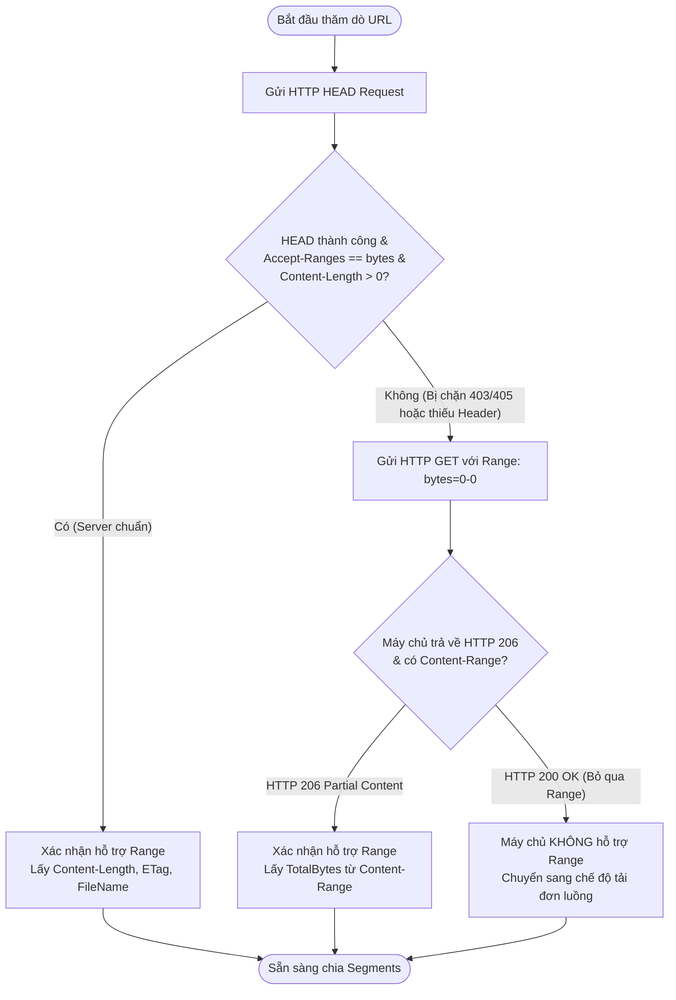
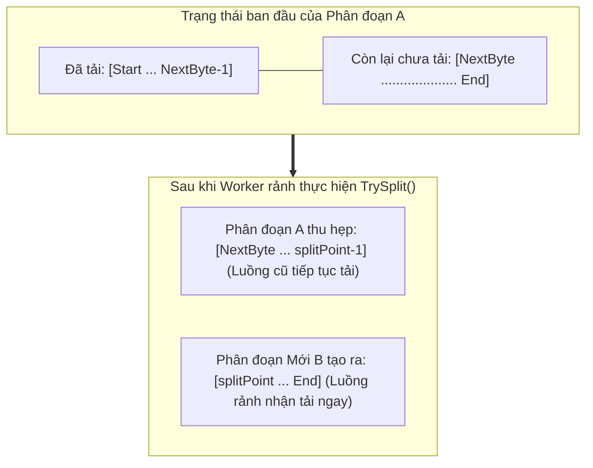

# TÀI LIỆU KỸ THUẬT CHUYÊN SÂU: CƠ CHẾ HOẠT ĐỘNG & KIẾN TRÚC LÕI TẢI TỆP
### Đề tài PBL4: Ứng dụng Tăng tốc Tải tệp (DUT Download Accelerator)
**Bộ môn: Hệ điều hành & Mạng máy tính — Khoa Công nghệ Thông tin, Trường Đại học Bách Khoa - ĐHĐN**

---

## MỤC LỤC
1. [TỔNG QUAN KIẾN TRÚC & BẢNG ÁNH XẠ FILE CHƯƠNG TRÌNH](#1-tổng-quan-kiến-trúc--bảng-ánh-xạ-file-chương-trình)
2. [CHỦ ĐỀ 1: GỬI HTTP HEAD REQUEST & KIỂM TRA ACCEPT-RANGES](#2-chủ-đề-1-gửi-http-head-request--kiểm-tra-accept-ranges)
   - 2.1 Bản chất Mạng & Giao thức HTTP
   - 2.2 Các Header Cốt lõi Cần Nắm
   - 2.3 Cơ chế Dự phòng Thông minh (GET Range 0-0 Fallback)
   - 2.4 File Chương trình & Phân tích Mã nguồn (`RemoteProbe.cs`)
3. [CHỦ ĐỀ 2: THUẬT TOÁN CHIA FILE THÀNH NHIỀU PHẦN (SEGMENTS / CHUNKS)](#3-chủ-đề-2-thuật-toán-chia-file-thành-nhiều-phần-segments--chunks)
   - 3.1 Nguyên lý Chia đoạn & Công thức Phân phối Byte Dư
   - 3.2 Ngưỡng Kích thước Tối thiểu Chống Vi Phân mảnh (`MinSegmentSize`)
   - 3.3 Thuật toán Chia đôi Phân đoạn Động (Dynamic Segment Splitting / Work Stealing kiểu IDM)
   - 3.4 File Chương trình & Phân tích Mã nguồn (`Segment.cs`)
4. [CHỦ ĐỀ 3: TẢI SONG SONG BẰNG NHIỀU KẾT NỐI (HTTP RANGE REQUESTS)](#4-chủ-đề-3-tải-song-song-bằng-nhiều-kết-nối-http-range-requests)
   - 4.1 Tại sao Tải Song song lại Nhanh hơn Tải Truyền thống? (Góc nhìn TCP & BDP)
   - 4.2 Tiêu chuẩn HTTP Range (RFC 7233) & Cơ chế Bảo vệ `If-Range`
   - 4.3 Cấu hình Socket & Connection Pool trong .NET (`MaxConnectionsPerServer = 64`)
   - 4.4 File Chương trình & Phân tích Mã nguồn (`DownloadJob.cs`)
5. [CHỦ ĐỀ 4: CƠ CHẾ GHI ĐĨA — GHI TRỰC TIẾP (FILESTREAM + SEEK) VS FILE TẠM GHÉP LẠI](#5-chủ-đề-4-cơ-chế-ghi-đĩa--ghi-trực-tiếp-filestream--seek-vs-file-tạm-ghép-lại)
   - 5.1 So sánh Chi tiết 2 Giải pháp Ghi đĩa
   - 5.2 Cơ chế Cấp phát Trước Kích thước Tệp (`fs.SetLength`)
   - 5.3 Chia sẻ FileStream Đa Luồng (`FileShare.ReadWrite`) & Ghi Trực tiếp với `Seek`
   - 5.4 Kỹ thuật Ghi Không Đệm (`bufferSize = 1`) Chống Mất Dữ liệu khi Crash
   - 5.5 File Chương trình & Phân tích Mã nguồn (`DownloadJob.cs`)
6. [CHỦ ĐỀ 5: HỖ TRỢ RESUME (TIẾP TỤC TẢI & NGUYÊN TỬ HÓA TRẠNG THÁI)](#6-chủ-đề-5-hỗ-trợ-resume-tiếp-tục-tải--nguyên-tử-hóa-trạng-thái)
   - 6.1 Cơ chế Khôi phục Dòng Byte (`NextByte = Start + Downloaded`)
   - 6.2 Cấu trúc Tệp Metadata `.dlmeta`
   - 6.3 Kỹ thuật Ghi Nguyên tử (Atomic File Replacement) Chống Hỏng File
   - 6.4 File Chương trình & Phân tích Mã nguồn (`DownloadMeta.cs`, `DownloadJob.cs`)
7. [CHỦ ĐỀ 6: CÁC TÍNH NĂNG NÂNG CAO (QUEUE, PAUSE/RESUME, SPEED LIMIT, PROXY, RETRY)](#7-chủ-đề-6-các-tính-năng-nâng-cao-queue-pauseresume-speed-limit-proxy-retry)
   - 7.1 Quản lý Hàng đợi Tải (Queue Management) (`DownloadManager.cs`)
   - 7.2 Tạm dừng & Tiếp tục Luồng An toàn (Pause/Resume via CancellationToken)
   - 7.3 Giới hạn Tốc độ (Speed Limiter / Token Bucket) (`SpeedLimiter.cs`)
   - 7.4 Cấu hình Proxy (HTTP / SOCKS5 & Authentication) (`DownloadManager.cs`)
   - 7.5 Cơ chế Thử lại Thông minh & Exponential Backoff (`DownloadJob.cs`)
8. [BỘ CÂU HỎI VẤN ĐÁP KỸ THUẬT & TRẢ LỜI CHUẨN KHI BẢO VỆ PBL4](#8-bộ-câu-hỏi-vấn-đáp-kỹ-thuật--trả-lời-chuẩn-khi-bảo-vệ-pbl4)

---

## 1. TỔNG QUAN KIẾN TRÚC & BẢNG ÁNH XẠ FILE CHƯƠNG TRÌNH

Dự án **DUT Download Accelerator** được tổ chức theo mô hình phân tầng chặt chẽ. Dưới đây là bảng tổng hợp các file nguồn C# tại thư mục `WindowsFormsApp/Download/` và chức năng kỹ thuật tương ứng:

| Tên File Mã Nguồn | Lớp / Cấu Trúc (Class) | Phương Thức Trọng Tâm | Nhiệm Vụ Kỹ Thuật Đảm Nhiệm |
| :--- | :--- | :--- | :--- |
| [`RemoteProbe.cs`](file:///c:/PBL4/WindowsFormsApp/Download/RemoteProbe.cs) | `RemoteProbe`, `RemoteFileInfo` | `InspectAsync`, `ProbeAsync` | Gửi HTTP HEAD, kiểm tra `Accept-Ranges`, fallback gửi `GET Range: bytes=0-0`, trích xuất tên file, dung lượng, ETag, Last-Modified. |
| [`Segment.cs`](file:///c:/PBL4/WindowsFormsApp/Download/Segment.cs) | `Segment`, `SegmentPlanner` | `SegmentPlanner.Split`, `TrySplit`, `Add` | Tính toán chia $N$ phân đoạn ban đầu `[Start, End]`, thuật toán chia đôi phân đoạn động (Dynamic Segment Splitting / Work Stealing kiểu IDM). |
| [`DownloadJob.cs`](file:///c:/PBL4/WindowsFormsApp/Download/DownloadJob.cs) | `DownloadJob` | `RunMultiSegmentAsync`, `RunWorkerLoopAsync`, `DownloadSegmentOnceAsync`, `PumpAsync`, `VerifyIntegrity` | Quản lý vòng đời tải của 1 tệp: cấp phát trước tệp đích, mở song song $N$ kết nối HTTP Range, ghi trực tiếp bằng `FileStream.Seek`, cơ chế Retry với Exponential Backoff, tính băm SHA-256. |
| [`DownloadMeta.cs`](file:///c:/PBL4/WindowsFormsApp/Download/DownloadMeta.cs) | `DownloadMeta`, `SegmentMeta`, `MetaStore` | `MetaStore.Save`, `MetaStore.Load`, `MetaStore.Delete` | Định nghĩa cấu trúc lưu tiến độ `.dlmeta`, áp dụng kỹ thuật ghi nguyên tử (Atomic Replace) để Resume an toàn sau khi tắt app. |
| [`DownloadManager.cs`](file:///c:/PBL4/WindowsFormsApp/Download/DownloadManager.cs) | `DownloadManager`, `PendingDownloadItem` | `CreateHttpClient`, `CheckAndProcessQueue`, `AddJobAsync`, `OnTick` | Điều phối hàng đợi tải (`MaxConcurrentDownloads`), cấu hình Connection Pool (`MaxConnectionsPerServer = 64`), cấu hình Proxy (HTTP/SOCKS5), hẹn giờ báo tiến độ lên UI. |
| [`SpeedLimiter.cs`](file:///c:/PBL4/WindowsFormsApp/Download/SpeedLimiter.cs) | `SpeedLimiter` | `WaitAsync` | Thuật toán Virtual Clock / Token Bucket điều phối băng thông đa luồng, sử dụng `Stopwatch.GetTimestamp()` không block luồng. |
| [`ChecksumHelper.cs`](file:///c:/PBL4/WindowsFormsApp/Download/ChecksumHelper.cs) | `ChecksumHelper` | `ComputeSha256`, `ComputeMd5` | Kiểm tra tính toàn vẹn dữ liệu của tệp sau khi tải xong bằng mã băm SHA-256 và MD5. |
| [`AntivirusScanner.cs`](file:///c:/PBL4/WindowsFormsApp/Download/AntivirusScanner.cs) | `AntivirusScanner` | `ScanFileAsync` | Quét mã độc tự động tệp vừa tải xong qua trình diệt virus Windows Defender (Win32 CLI & `IAttachmentExecute`). |

---

## 2. CHỦ ĐỀ 1: GỬI HTTP HEAD REQUEST & KIỂM TRA ACCEPT-RANGES

### 2.1 Bản chất Mạng & Giao thức HTTP
Trong mô hình client-server, trước khi bắt đầu tải một tệp tin lớn, máy khách **không bao giờ nên tải ngay lập tức bằng lệnh `GET` thông thường**. Lý do:
1. Nếu tải ngay bằng `GET`, máy chủ sẽ truyền toàn bộ thân tệp (Response Body) từ byte đầu tiên, gây lãng phí băng thông nếu ta muốn chia nhỏ tệp để tải đa luồng.
2. Phương thức **`HEAD` (HTTP RFC 7231, Mục 4.3.2)** có cú pháp và hành vi hoàn toàn tương đương phương thức `GET`, ngoại trừ một điều kiện tiên quyết: **Máy chủ chỉ phản hồi các Header HTTP mà KHÔNG gửi kèm Response Body (nội dung tệp)**.
3. Nhờ đó, máy khách thu thập được toàn bộ siêu dữ liệu (Metadata) về tệp tin chỉ trong vài mili-giây với lưu lượng mạng tiêu thụ cực nhỏ (chỉ vài trăm byte cho gói tin Header TCP).

### 2.2 Các Header Cốt lõi Cần Nắm
Khi gửi `HEAD`, ứng dụng phân tích các Header phản hồi sau từ máy chủ:
* **`Content-Length`:** Cho biết tổng kích thước của tệp tính theo Byte. Nếu server không trả về header này (hoặc trả về chunked transfer encoding), ta không thể biết trước dung lượng để chia phân đoạn.
* **`Accept-Ranges: bytes`:** Đây là chỉ số quyết định! Nếu Header này xuất hiện với giá trị `bytes`, máy chủ chính thức xác nhận có hỗ trợ tải từng phần theo phạm vi byte (Byte-Range Requests).
* **`ETag` (Entity Tag) & `Last-Modified`:** Định danh phiên bản duy nhất của tệp tại thời điểm thăm dò. Lưu giữ giá trị này là điều kiện bắt buộc để phục vụ cơ chế Resume an toàn sau này.
* **`Content-Disposition`:** Ví dụ `attachment; filename="data.zip"`. Giúp lấy được tên file gốc do máy chủ chỉ định (kể cả khi URL là link rút gọn hoặc link động dạng `download.php?id=123`).

### 2.3 Cơ chế Dự phòng Thông minh (GET Range 0-0 Fallback)
Trong môi trường Internet thực tế, có 2 trường hợp phổ biến khiến lệnh `HEAD` thất bại:
1. Nhiều máy chủ (như Google Drive, OneDrive, Cloudflare, hoặc web server cấu hình bảo mật) chặn phương thức `HEAD` và phản hồi mã lỗi `403 Forbidden` hoặc `405 Method Not Allowed`.
2. Một số máy chủ CDN hỗ trợ Range rất tốt, nhưng trong phản hồi của lệnh `HEAD` lại quên gắn header `Accept-Ranges: bytes`.

> [!IMPORTANT]
> **Giải pháp kỹ thuật của DUT Download Accelerator:**
> Nếu gửi `HEAD` thất bại hoặc không thấy `Accept-Ranges`, ứng dụng tự động thực hiện Bước 2 (Fallback): Gửi một lệnh **`GET` chỉ yêu cầu đúng byte số 0 (`Range: bytes=0-0`)**.
> * Nếu máy chủ hỗ trợ Range: Máy chủ sẽ trả về mã **`HTTP 206 Partial Content`** cùng header **`Content-Range: bytes 0-0/Tổng_Dung_Lượng`**. Ta lấy được tổng dung lượng qua `Content-Range.Length` và xác nhận 100% máy chủ hỗ trợ Range!
> * Nhờ đọc Header và hủy kết nối ngay (`using(resp)`), ứng dụng chỉ tốn đúng 1 byte mạng duy nhất nhưng giải quyết triệt để vấn đề máy chủ chặn `HEAD`.



### 2.4 File Chương trình & Phân tích Mã nguồn (`RemoteProbe.cs`)
Chức năng này được đóng gói độc lập trong file [`RemoteProbe.cs`](file:///c:/PBL4/WindowsFormsApp/Download/RemoteProbe.cs). Phương thức `InspectAsync` kết hợp cả 2 bước:

```csharp
// Trích từ WindowsFormsApp/Download/RemoteProbe.cs (dòng 31-58)
public static async Task<RemoteFileInfo> InspectAsync(HttpClient http, string url, CancellationToken ct)
{
    RemoteFileInfo head = null;
    try
    {
        // Bước 1: Thử nghiệm nhanh bằng HTTP HEAD
        head = await ProbeAsync(http, HttpMethod.Head, url, ct).ConfigureAwait(false);
    }
    catch (HttpRequestException) { }
    catch (TimeoutException) { }
    catch (DownloadException) { }   // HEAD bị từ chối (403/405...) -> chuyển bước 2

    // Nếu HEAD thành công trọn vẹn và xác nhận Range -> dùng kết quả ngay
    if (head != null && head.Length > 0 && head.SupportsRanges)
    {
        Finish(head, url);
        return head;
    }

    // Bước 2: Dự phòng bằng GET Range: bytes=0-0
    RemoteFileInfo probe = await ProbeAsync(http, HttpMethod.Get, head != null ? head.Url : url, ct).ConfigureAwait(false);
    if (head != null)
    {
        if (string.IsNullOrEmpty(probe.FileName)) probe.FileName = head.FileName;
        if (probe.Length <= 0) probe.Length = head.Length;
        if (probe.ETag == null) probe.ETag = head.ETag;
        if (!probe.LastModified.HasValue) probe.LastModified = head.LastModified;
    }
    Finish(probe, url);
    return probe;
}
```

Trong hàm `ProbeAsync`, logic bắt header `ContentRange` được thực hiện như sau:
```csharp
// Trích từ WindowsFormsApp/Download/RemoteProbe.cs (dòng 90-102)
ContentRangeHeaderValue cr = resp.Content.Headers.ContentRange;
if (code == 206 && cr != null && cr.Length.HasValue)
{
    info.Length = cr.Length.Value;
    info.SupportsRanges = true; // Máy chủ trả về 206 -> Hỗ trợ tải đa luồng
}
else
{
    info.Length = resp.Content.Headers.ContentLength ?? -1;
    // Với HEAD: Kiểm tra Accept-Ranges có chứa chữ "bytes"
    info.SupportsRanges = method == HttpMethod.Head
        && resp.Headers.AcceptRanges.Contains("bytes", StringComparer.OrdinalIgnoreCase);
}
```

---

## 3. CHỦ ĐỀ 2: THUẬT TOÁN CHIA FILE THÀNH NHIỀU PHẦN (SEGMENTS / CHUNKS)

### 3.1 Nguyên lý Chia đoạn & Công thức Phân phối Byte Dư
Khi máy chủ hỗ trợ Range và biết được `TotalBytes`, ứng dụng sẽ phân chia không gian byte từ $0$ đến $TotalBytes - 1$ thành $N$ phân đoạn độc lập.
* Mỗi phân đoạn là một phạm vi kín ở cả 2 đầu: $[Start, End]$.
* **Công thức toán học chia đều:**
  $$\text{baseSize} = \lfloor \frac{\text{TotalBytes}}{N} \rfloor$$
  $$\text{extra} = \text{TotalBytes} \pmod N$$
* **Nguyên tắc chia byte dư:** Nếu chia có dư ($\text{extra} > 0$), $\text{extra}$ phân đoạn đầu tiên sẽ được cộng thêm đúng $1$ byte. Cách làm này đảm bảo tổng kích thước của $N$ phân đoạn luôn khớp chính xác tuyệt đối với `TotalBytes`, không bị hụt và không bị lệch dù chỉ 1 byte!

**Ví dụ trực quan:** Tải tệp có dung lượng $10$ bytes với $N = 3$ luồng:
* $\text{baseSize} = 10 / 3 = 3$ bytes. Phần dư $\text{extra} = 10 \pmod 3 = 1$ byte.
* Phân đoạn 0: Nhận $3 + 1 = 4$ bytes $\to$ Phạm vi: `bytes 0-3` ($Start=0, End=3$).
* Phân đoạn 1: Nhận $3 + 0 = 3$ bytes $\to$ Phạm vi: `bytes 4-6` ($Start=4, End=6$).
* Phân đoạn 2: Nhận $3 + 0 = 3$ bytes $\to$ Phạm vi: `bytes 7-9` ($Start=7, End=9$).
* Tổng cộng: $(3 - 0 + 1) + (6 - 4 + 1) + (9 - 7 + 1) = 4 + 3 + 3 = 10$ bytes (Hoàn hảo!).

### 3.2 Ngưỡng Kích thước Tối thiểu Chống Vi Phân mảnh (`MinSegmentSize`)
Tại sao không chia file nhỏ (ví dụ 100 KB) thành 16 luồng?
* Trong mạng máy tính, việc thiết lập một kết nối TCP đòi hỏi: Bắt tay 3 bước TCP (3-way Handshake: SYN, SYN-ACK, ACK) + Bắt tay TLS/SSL nếu dùng HTTPS.
* Quá trình này tốn từ $1 \to 3$ vòng lặp trễ mạng (RTT - Round Trip Time).
* Nếu kích thước phân đoạn quá nhỏ, thời gian thiết lập kết nối socket còn lâu hơn thời gian truyền dữ liệu!
* Do đó, ứng dụng đặt ngưỡng `MinSegmentSize = 256 KB`. Nếu tệp quá nhỏ, số luồng sẽ tự động thu giảm tương ứng:
  $$\text{threads} = \min(\text{requestedThreads}, \max(1, \lfloor \frac{\text{TotalBytes}}{\text{MinSegmentSize}} \rfloor))$$

### 3.3 Thuật toán Chia đôi Phân đoạn Động (Dynamic Segment Splitting / Work Stealing kiểu IDM)
Trong quá trình tải thực tế, đường truyền mạng không bao giờ ổn định đều nhau trên tất cả các luồng:
* Luồng 1 có thể tải rất nhanh và hoàn thành sớm.
* Luồng 2 có thể bị "nghẽn cổ chai" (Slow Stream) do định tuyến mạng hoặc server giới hạn tốc độ luồng đó.
* Nếu theo cách truyền thống: Luồng 1 tải xong sẽ ngồi nhàn rỗi (Idle), chờ luồng 2 tải nốt $\to$ Lãng phí tài nguyên!

> [!TIP]
> **Cơ chế Chia nhỏ Phân đoạn Động (Dynamic Segment Splitting):**
> 1. Khi một Worker Task hoàn thành phân đoạn của mình sớm, nó kiểm tra danh sách các phân đoạn đang chạy.
> 2. Tìm phân đoạn đang chạy còn **nhiều byte chưa tải nhất** ($\text{Remaining} = End - NextByte + 1$).
> 3. Nếu số byte còn lại $\ge \text{MinSplitSize}$ ($512\text{ KB}$), Worker sẽ thực hiện thao tác **"Đánh cắp công việc" (Work Stealing)**:
>    * Thu hẹp phân đoạn cũ về nửa đầu: $[Start, splitPoint - 1]$.
>    * Tạo một phân đoạn mới gánh nửa sau: $[splitPoint, oldEnd]$.
>    * Luồng rảnh rỗi sẽ nhận ngay phân đoạn mới này và mở kết nối tải tiếp.
> 4. Toàn bộ thao tác thu hẹp `_end` được khóa bảo vệ luồng bằng `lock(_lock)` trong `Segment.cs`, đảm bảo dữ liệu luôn liên tục, không bao giờ bị ghi đè.



### 3.4 File Chương trình & Phân tích Mã nguồn (`Segment.cs`)
Logic thuật toán nằm tại [`Segment.cs`](file:///c:/PBL4/WindowsFormsApp/Download/Segment.cs):

```csharp
// Trích từ WindowsFormsApp/Download/Segment.cs (dòng 110-140)
public static class SegmentPlanner
{
    public const int MaxThreads = 16;
    public const long MinSegmentSize = 256 * 1024; // 256 KB: không chia nhỏ hơn mức này
    public const long MinSplitSize = 512 * 1024;   // 512 KB: ngưỡng tối thiểu để chia đôi động

    public static List<Segment> Split(long totalBytes, int requestedThreads)
    {
        if (totalBytes <= 0) throw new ArgumentOutOfRangeException(nameof(totalBytes));

        long bySize = Math.Max(1, totalBytes / MinSegmentSize);
        int threads = (int)Math.Max(1, Math.Min(Math.Min(requestedThreads, MaxThreads), bySize));

        long baseSize = totalBytes / threads;
        long extra = totalBytes % threads; // Số byte dư

        var list = new List<Segment>(threads);
        long start = 0;
        for (int i = 0; i < threads; i++)
        {
            long size = baseSize + (i < extra ? 1 : 0); // Phân phối byte dư
            list.Add(new Segment(i, start, start + size - 1));
            start += size;
        }
        return list;
    }
}
```

Hàm cắt đôi phân đoạn động an toàn đa luồng trong lớp `Segment`:
```csharp
// Trích từ WindowsFormsApp/Download/Segment.cs (dòng 78-106)
public bool TrySplit(int newIndex, long minSplitSize, out Segment newSegment)
{
    lock (_lock)
    {
        if (Finished) { newSegment = null; return false; }

        long next = Start + Interlocked.Read(ref _downloaded);
        long remaining = _end - next + 1;
        if (remaining < minSplitSize) { newSegment = null; return false; }

        long half = remaining / 2;
        long splitPoint = next + half;
        long oldEnd = _end;

        // Cập nhật lại End của phân đoạn hiện tại (thu hẹp)
        _end = splitPoint - 1;

        // Tạo phân đoạn mới gánh nửa còn lại
        newSegment = new Segment(newIndex, splitPoint, oldEnd);
        return true;
    }
}
```

---

## 4. CHỦ ĐỀ 3: TẢI SONG SONG BẰNG NHIỀU KẾT NỐI (HTTP RANGE REQUESTS)

### 4.1 Tại sao Tải Song song lại Nhanh hơn Tải Truyền thống? (Góc nhìn TCP & BDP)
Rất nhiều người lầm tưởng rằng: *"Băng thông mạng nhà tôi là 100 Mbps thì tải 1 luồng hay nhiều luồng cũng chỉ tối đa 100 Mbps, tại sao đa luồng lại nhanh hơn?"*. 
Dưới góc độ **Mạng máy tính chuyên sâu**, việc tải đa luồng giải quyết 3 rào cản vật lý cốt lõi:

1. **Giới hạn BDP (Bandwidth-Delay Product) & Cửa sổ nhận TCP (TCP Receive Window):**
   * Theo công thức mạng: $\text{Throughput tối đa} \le \frac{\text{TCP Window Size}}{\text{RTT (Round Trip Time)}}$.
   * Nếu máy chủ ở xa (ví dụ Mỹ, châu Âu có ping RTT 200ms), một kết nối TCP đơn lẻ dù đường truyền mạng rất mạnh cũng không thể "bơm" đầy ống mạng vì phải chờ tín hiệu ACK xác nhận từ đầu bên kia.
   * Khi mở $N$ kết nối TCP song song, ứng dụng nhân tổng dung lượng cửa sổ nhận lên gấp $N$ lần, giúp lấp đầy đường truyền vật lý.
2. **Cơ chế Điều khiển Tắc nghẽn TCP (Congestion Control - TCP Slow Start):**
   * Kết nối TCP luôn bắt đầu thận trọng (Slow Start) và khi gặp hiện tượng rớt gói (Packet Loss), thuật toán AIMD (Additive Increase / Multiplicative Decrease) sẽ lập tức giảm tốc độ truyền đi một nửa ($50\%$).
   * Khi dùng $N$ luồng độc lập, nếu một luồng bị rớt gói và tụt tốc độ, $N-1$ luồng còn lại vẫn giữ nguyên tốc độ đỉnh, duy trì thông lượng ổn định liên tục.
3. **Giới hạn Băng thông trên từng Connection từ phía Server (Per-thread Rate Limiting):**
   * Nhiều máy chủ lưu trữ (Google Drive, Fshare, Mega...) bóp băng thông tối đa của 1 kết nối (ví dụ tối đa 2 MB/s mỗi socket).
   * Mở 8 kết nối đồng nghĩa với việc ta kéo được $8 \times 2\text{ MB/s} = 16\text{ MB/s}$!

### 4.2 Tiêu chuẩn HTTP Range (RFC 7233) & Cơ chế Bảo vệ `If-Range`
Mỗi Worker Task khi bắt đầu tải một Segment sẽ gửi request HTTP với header chuẩn:
```http
GET /files/large-archive.iso HTTP/1.1
Host: cdn.example.com
Range: bytes=10485760-20971519
If-Range: "33a64df551425fcc55e4d42a148795d9f25f89d4"
```
* **Header `Range: bytes=start-end`:** Yêu cầu máy chủ chỉ cắt lát dữ liệu từ byte `start` đến byte `end`.
* **Mã phản hồi thành công `HTTP 206 Partial Content`:** Kèm header `Content-Range: bytes 10485760-20971519/104857600`.
* **Cơ chế bảo vệ `If-Range`:** Nếu trong lúc ta đang tải dở mà người quản trị máy chủ thay thế file bằng một file mới, header `If-Range` (gửi kèm `ETag` hoặc `Last-Modified`) sẽ phát hiện ngay. Thay vì trả về byte rác của phiên bản mới làm hỏng file, máy chủ sẽ từ chối hoặc trả về mã `HTTP 200 OK` (toàn bộ file mới), ứng dụng sẽ phát hiện và xử lý an toàn.

### 4.3 Cấu hình Socket & Connection Pool trong .NET (`MaxConnectionsPerServer = 64`)
Mặc định trong .NET Framework, lớp `ServicePointManager` và `HttpClientHandler` chỉ cho phép **tối đa 2 kết nối đồng thời tới cùng một Host IP**! Nếu không cấu hình lại, dù bạn có tạo 16 luồng, 14 luồng kia sẽ bị xếp hàng chờ (Queue) trong tầng Socket của HĐH.

Trong [`DownloadManager.cs`](file:///c:/PBL4/WindowsFormsApp/Download/DownloadManager.cs) (dòng 104-159), cấu hình mạng tối ưu được thiết lập:
```csharp
var handler = new HttpClientHandler
{
    AllowAutoRedirect = true,
    MaxAutomaticRedirections = 8,
    // BẮT BUỘC TẮT NÉN: Nếu server nén gzip, vị trí byte không còn tương ứng với file gốc
    AutomaticDecompression = DecompressionMethods.None,
    ServerCertificateCustomValidationCallback = (sender, cert, chain, sslPolicyErrors) => true
};
// NÂNG HẠN MỨC KẾT NỐI ĐA LUỒNG TỐI ĐA 64 KẾT NỐI ĐỒNG THỜI
handler.MaxConnectionsPerServer = 64;

var client = new HttpClient(handler);
client.Timeout = Timeout.InfiniteTimeSpan; // Kiểm soát timeout thủ công theo từng khâu
client.DefaultRequestHeaders.AcceptEncoding.Add(new StringWithQualityHeaderValue("identity"));
```

### 4.4 File Chương trình & Phân tích Mã nguồn (`DownloadJob.cs`)
Toàn bộ quy trình điều phối đa luồng diễn ra tại `RunMultiSegmentAsync` và `RunWorkerLoopAsync` trong [`DownloadJob.cs`](file:///c:/PBL4/WindowsFormsApp/Download/DownloadJob.cs):
```csharp
// Trích từ WindowsFormsApp/Download/DownloadJob.cs (dòng 251-275)
private async Task RunMultiSegmentAsync(CancellationToken ct)
{
    // Cấp phát trước file đích đúng kích thước TotalBytes
    EnsureTargetFile();

    using (var failCts = CancellationTokenSource.CreateLinkedTokenSource(ct))
    {
        int workerCount = Math.Max(1, Math.Min(RequestedThreads, Segments.Count));
        var workerTasks = new List<Task>(workerCount);

        // Khởi động N Worker Tasks chạy độc lập
        for (int i = 0; i < workerCount; i++)
        {
            int workerId = i + 1;
            workerTasks.Add(RunWorkerLoopAsync(workerId, failCts));
        }

        // Chờ tất cả worker hoàn tất
        await Task.WhenAll(workerTasks).ConfigureAwait(false);
    }

    // Kiểm tra tính toàn vẹn từng byte
    VerifyIntegrity();
}
```

---

## 5. CHỦ ĐỀ 4: CƠ CHẾ GHI ĐĨA — GHI TRỰC TIẾP (FILESTREAM + SEEK) VS FILE TẠM GHÉP LẠI

### 5.1 So sánh Chi tiết 2 Giải pháp Ghi đĩa

Đây là một trong những chủ đề quan trọng nhất trong đề tài Hệ điều hành & Mạng máy tính. Có 2 cách tiếp cận trong kỹ thuật phần mềm:

| Tiêu Chí Đánh Giá | Phương Pháp 1: Ghi Ra Các File Tạm Rồi Ghép Lại | Phương Pháp 2: Ghi Trực Tiếp Bằng FileStream + Seek (DUT Download Accelerator) |
| :--- | :--- | :--- |
| **Cơ chế thực hiện** | Mỗi luồng tạo một file riêng (`file.part0`, `file.part1`...). Khi tất cả luồng tải xong, mở một luồng đọc từ part0..partN rồi ghi nối đuôi vào file chính thức. | Mở ngay file chính thức, cấp phát trước dung lượng (`SetLength`). Các luồng dùng chung file với cờ `FileShare.ReadWrite`, mỗi luồng `fs.Seek(offset, SeekOrigin.Begin)` và ghi song song. |
| **Thời gian hoàn tất** | **Rất chậm đối với file lớn.** Khi tải xong 1 file game 20 GB, người dùng phải chờ thêm 3 - 5 phút để hệ thống đọc và ghép nối 20 GB dữ liệu trên ổ đĩa. | **Tức thì (0 mili-giây).** Byte cuối cùng tải về xong cũng là lúc file hoàn chỉnh 100%. Không tốn thêm một giây nào để ghép file. |
| **Áp lực I/O Ổ đĩa** | **Gấp đôi (200% Disk Writes).** Ghi xuống đĩa 20 GB cho các file tạm, sau đó đọc lại 20 GB và ghi tiếp 20 GB vào file đích $\to$ Hao mòn ổ cứng SSD. | **Tối ưu tuyệt đối (100% Disk Writes).** Dữ liệu mạng nhận được đến đâu được ghi thẳng vào vị trí đích đến đó đúng 1 lần duy nhất. |
| **Không gian ổ đĩa yêu cầu** | Đòi hỏi trống **gấp đôi dung lượng file** (File 20 GB cần ổ đĩa trống ít nhất 40 GB để chứa file tạm + file ghép). | Chỉ đòi hỏi đúng dung lượng của file gốc (File 20 GB chỉ cần trống 20 GB). |
| **Độ phức tạp lập trình** | Đơn giản, không lo xung đột ghi file. | Đòi hỏi quản lý phân đoạn byte cực kỳ chặt chẽ để các luồng không ghi đè lên phạm vi của nhau. |

DUT Download Accelerator áp dụng **Phương pháp 2: Ghi trực tiếp bằng FileStream với Seek** để đạt hiệu năng tối đa tương tự như phần mềm thương mại hàng đầu Internet Download Manager (IDM).

### 5.2 Cơ chế Cấp phát Trước Kích thước Tệp (`fs.SetLength`)
Trước khi cho các luồng Worker bắt đầu ghi, ứng dụng gọi hàm `EnsureTargetFile()`:
```csharp
// Trích từ WindowsFormsApp/Download/DownloadJob.cs (dòng 278-284)
private void EnsureTargetFile()
{
    using (var fs = new FileStream(TargetPath, FileMode.OpenOrCreate, FileAccess.Write, FileShare.ReadWrite))
    {
        if (fs.Length != TotalBytes) fs.SetLength(TotalBytes);
    }
}
```
* **Ý nghĩa Hệ điều hành:** Lệnh `fs.SetLength(TotalBytes)` yêu cầu hệ điều hành Windows (hệ thống tệp NTFS) cấp phát trước toàn bộ không gian cluster đĩa cho tệp tin. 
* **Lợi ích:**
  1. Kiểm tra ngay lập tức xem ổ cứng có đủ dung lượng trống hay không. Nếu không đủ dung lượng, HĐH sẽ ném ra lỗi `IOException: Disk full` ngay từ đầu, tránh việc tải được 99% mới báo lỗi hết ổ đĩa.
  2. Giảm thiểu phân mảnh đĩa (Disk Fragmentation), vì NTFS sẽ tìm các vùng sector liên tục để phân bổ trước.

### 5.3 Chia sẻ FileStream Đa Luồng (`FileShare.ReadWrite`) & Ghi Trực tiếp với `Seek`
Trong Windows, mặc định khi một tiến trình mở file thì file đó sẽ bị khóa độc quyền (Exclusive Lock).
* Bằng cách truyền tham số **`FileShare.ReadWrite`**, Windows cho phép nhiều FileStream mở đồng thời trên cùng một file vật lý trên đĩa.
* Mỗi luồng Worker mở FileStream riêng và di chuyển con trỏ tệp đến đúng vị trí bắt đầu của mình bằng phương thức **`fs.Seek(start, SeekOrigin.Begin)`**.
* Vì mỗi luồng chỉ thao tác trên dải byte độc lập của nó (ví dụ Luồng 1 ghi từ byte 0 đến 1000, Luồng 2 ghi từ byte 1001 đến 2000), hệ điều hành đảm bảo việc ghi đĩa diễn ra song song hoàn toàn độc lập và không xảy ra Race Condition!

### 5.4 Kỹ thuật Ghi Không Đệm (`bufferSize = 1`) Chống Mất Dữ liệu khi Crash
Một phát hiện kiến trúc rất thông minh trong `DownloadJob.cs` dòng 443:
```csharp
using (var fs = new FileStream(TargetPath, FileMode.Open, FileAccess.Write, FileShare.ReadWrite, 1, true))
{
    fs.Seek(start, SeekOrigin.Begin);
    long got = await PumpAsync(resp, fs, seg, ct).ConfigureAwait(false);
}
```
* Tham số `bufferSize = 1`: Tắt bỏ tầng bộ đệm người dùng (User-space Buffer) của .NET `FileStream`.
* Khi `dest.WriteAsync` hoàn thành, dữ liệu được giao ngay cho hệ điều hành (OS Page Cache).
* Nhờ đó, số byte vừa được ghi được cộng vào biến `seg.Downloaded` và lưu vào file `.dlmeta`. Nếu máy tính bị sập nguồn đột ngột, số byte ghi nhận trong metadata chắc chắn đã nằm an toàn trên đĩa, không bị tình trạng metadata báo đã tải nhưng đĩa thì chưa ghi!

---

## 6. CHỦ ĐỀ 5: HỖ TRỢ RESUME (TIẾP TỤC TẢI & NGUYÊN TỬ HÓA TRẠNG THÁI)

### 6.1 Cơ chế Khôi phục Dòng Byte (`NextByte = Start + Downloaded`)
Khi một tác vụ tải bị tạm dừng (Pause), mất mạng hoặc ứng dụng bị tắt:
* Mỗi phân đoạn ghi nhận số byte thực tế nó đã ghi xuống đĩa: `Downloaded`.
* Khi bấm Resume, điểm bắt đầu tải tiếp theo của phân đoạn được tính toán chính xác bằng công thức:
  $$\text{NextByte} = \text{Start} + \text{Downloaded}$$
* Worker chỉ cần gửi request HTTP với dải byte:
  $$\text{Range: bytes} = \text{NextByte} - \text{End}$$
* Ví dụ: Phân đoạn từ `1000 - 2000` (dài 1001 bytes). Đã tải được $400$ bytes. Lần sau mở lại, luồng chỉ yêu cầu tải từ `Range: bytes=1400-2000`. Không mất $1$ byte nào đã tải!

### 6.2 Cấu trúc Tệp Metadata `.dlmeta`
Mỗi khi có tác vụ tải, ứng dụng tạo một tệp metadata JSON nằm ngay cạnh file đích có đuôi `.dlmeta` (Ví dụ: `Windows_11.iso.dlmeta`). Cấu trúc JSON được định nghĩa trong [`DownloadMeta.cs`](file:///c:/PBL4/WindowsFormsApp/Download/DownloadMeta.cs):

```json
{
  "Url": "https://example.com/download/file.zip",
  "RemoteUrl": "https://cdn01.example.com/files/file.zip",
  "TotalBytes": 104857600,
  "ETag": "\"33a64df551425fcc55e4d42a148795d9f25f89d4\"",
  "LastModified": "2026-11-01T08:30:00+07:00",
  "Threads": 4,
  "Segments": [
    { "Index": 0, "Start": 0, "End": 26214399, "Downloaded": 26214400, "Finished": true },
    { "Index": 1, "Start": 26214400, "End": 52428799, "Downloaded": 15000000, "Finished": false },
    { "Index": 2, "Start": 52428800, "End": 78643199, "Downloaded": 12400000, "Finished": false },
    { "Index": 3, "Start": 78643200, "End": 104857599, "Downloaded": 8000000, "Finished": false }
  ]
}
```

### 6.3 Kỹ thuật Ghi Nguyên tử (Atomic File Replacement) Chống Hỏng File
Nếu ứng dụng đang ghi file `.dlmeta` mà người dùng tắt ngang ứng dụng hoặc mất điện đột ngột, file `.dlmeta` sẽ bị cắt cụt (Corrupted JSON) và lần sau không thể Resume được.

Để giải quyết vấn đề này, lớp `MetaStore` áp dụng mẫu thiết kế **Ghi Nguyên tử (Atomic Write)**:
```csharp
// Trích từ WindowsFormsApp/Download/DownloadMeta.cs (dòng 52-60)
public static void Save(string targetPath, DownloadMeta meta)
{
    string path = PathFor(targetPath);
    string tmp = path + ".tmp";

    // 1. Ghi toàn bộ dữ liệu ra tệp tạm .dlmeta.tmp trước
    File.WriteAllText(tmp, JsonSerializer.Serialize(meta));

    // 2. Sử dụng lời gọi hàm Win32 ReplaceFile nguyên tử để tráo đổi file tức thì
    if (File.Exists(path)) File.Replace(tmp, path, null);
    else File.Move(tmp, path);
}
```
* Hệ điều hành Windows đảm bảo lời gọi `File.Replace` diễn ra ở cấp độ con trỏ bảng băm thư mục của hệ thống tệp NTFS. Hoặc là file cũ còn nguyên, hoặc là file mới thay thế hoàn chỉnh, **tuyệt đối không bao giờ có trạng thái file dở dang**.

---

## 7. CHỦ ĐỀ 6: CÁC TÍNH NĂNG NÂNG CAO (QUEUE, PAUSE/RESUME, SPEED LIMIT, PROXY, RETRY)

### 7.1 Quản lý Hàng đợi Tải (Queue Management)
Được triển khai trong [`DownloadManager.cs`](file:///c:/PBL4/WindowsFormsApp/Download/DownloadManager.cs):
* **Vấn đề:** Nếu người dùng nhập 100 link tải cùng một lúc, nếu bật tải cả 100 task đồng thời thì số luồng mạng sẽ là $100 \times 8 = 800$ luồng socket. Việc này sẽ làm sập Router mạng gia đình, nghẽn đường truyền và tràn bộ nhớ RAM.
* **Cơ chế Hàng đợi:**
  * Thuộc tính `_maxConcurrentDownloads` (Mặc định: 2 tác vụ tải song song).
  * Các tác vụ vượt quá sẽ được giữ ở trạng thái `DownloadState.Queued` nằm trong danh sách `_queue` và `_pendingQueue`.
  * Hàm `CheckAndProcessQueue()` được tự động kích hoạt mỗi khi có một tác vụ hoàn tất (`Completed`), bị hủy (`Cancelled`), tạm dừng (`Paused`) hoặc khi người dùng thay đổi số lượng tải đồng thời trong Cài đặt:
```csharp
// Logic điều phối hàng đợi trong DownloadManager.cs
private void CheckAndProcessQueue()
{
    lock (_queueLock)
    {
        while (_maxConcurrentDownloads == 0 || ActiveDownloadingCount < _maxConcurrentDownloads)
        {
            if (_queue.Count == 0 && _pendingQueue.Count == 0) break;
            // Lấy task đầu tiên trong hàng đợi ra chạy
            string nextId = _queue.First();
            _queue.RemoveAt(0);
            if (_jobs.TryGetValue(nextId, out DownloadJob job))
            {
                job.Start();
            }
        }
    }
}
```

### 7.2 Tạm dừng & Tiếp tục Luồng An toàn (Pause/Resume via CancellationToken)
Để dừng tải ngay lập tức nhưng không làm hỏng dữ liệu:
* Lớp `DownloadJob` quản lý một đối tượng `CancellationTokenSource _cts`.
* Khi người dùng nhấn **"Tạm dừng"** (`Pause()`):
  1. Gọi `_cts.Cancel()`. Thao tác này phát tín hiệu dừng tới tất cả các kết nối mạng `net.ReadAsync` và `dest.WriteAsync` thông qua `CancellationToken`.
  2. Bắt ngoại lệ `OperationCanceledException` một cách êm ái (Graceful Shutdown).
  3. Gọi hàm `SaveMetaSafe()` để lưu lại chính xác số byte đã ghi của từng Segment xuống `.dlmeta`.
  4. Đổi trạng thái sang `DownloadState.Paused` và phát sự kiện lên giao diện người dùng.

### 7.3 Giới hạn Tốc độ (Speed Limiter / Token Bucket)
File [`SpeedLimiter.cs`](file:///c:/PBL4/WindowsFormsApp/Download/SpeedLimiter.cs) hiện thực thuật toán **Virtual Clock / Token Bucket kết hợp Leaky Bucket**:
* **Nguyên lý:** Khi cấu hình giới hạn tốc độ (ví dụ 2 MB/s $\to$ `BytesPerSecond = 2,097,152`), tất cả các luồng tải đều dùng chung một bộ giới hạn `_limiter`.
* Mỗi khi Worker đọc được một khối dữ liệu $N$ bytes từ mạng, trước khi ghi xuống đĩa, Worker bắt buộc phải gọi:
  ```csharp
  if (_limiter != null) await _limiter.WaitAsync(n, ct).ConfigureAwait(false);
  ```
* **Cách tính toán thời gian trễ:**
  * Dựa vào đồng hồ phần cứng độ phân giải cao `Stopwatch.GetTimestamp()`.
  * Tính chi phí thời gian mà khối dữ liệu $N$ bytes tiêu tốn:
    $$\text{costTicks} = \frac{N}{\text{BytesPerSecond}} \times \text{Stopwatch.Frequency}$$
  * Tính mốc thời gian luân phiên `_nextAvailableTicks`. Nếu luồng tải đang chạy quá nhanh, `WaitAsync` sẽ tính toán số mili-giây cần chờ và gọi `await Task.Delay(delayMs, ct)`.
  * **Ưu điểm vượt trội:** Chờ đợi bất đồng bộ (`await Task.Delay`), **không khóa chết Thread (No Thread-blocking)** của CPU, cho phép truyền dữ liệu mượt mà mà không làm giật lag giao diện.

### 7.4 Cấu hình Proxy (HTTP / SOCKS5 & Authentication)
Được hỗ trợ đầy đủ trong [`DownloadManager.cs`](file:///c:/PBL4/WindowsFormsApp/Download/DownloadManager.cs) thông qua `ProxySettings`:
* **Chế độ Proxy Hệ thống (System Proxy):** Sử dụng `WebRequest.GetSystemWebProxy()`, tự động kế thừa cấu hình Proxy của Windows hoặc VPN công ty.
* **Chế độ Proxy Tùy chỉnh (Custom Proxy):** Hỗ trợ cả 2 giao thức phổ biến:
  * **HTTP Proxy:** Dạng `http://proxy-host:port`
  * **SOCKS5 Proxy:** Dạng `socks5://proxy-host:port`
* **Xác thực người dùng (Proxy Authentication):** Hỗ trợ mật khẩu qua `NetworkCredential(Username, Password)`.
* **Bypass Local:** Bỏ qua Proxy khi truy cập vào các địa chỉ mạng nội bộ (Local/Intranet).

### 7.5 Cơ chế Thử lại Thông minh & Exponential Backoff
Trong quá trình tải tệp lớn, sự cố chập chờn mạng (Network Glitch / Transient Failures) là điều không thể tránh khỏi.
Hàm `DownloadSegmentWithRetryAsync` trong [`DownloadJob.cs`](file:///c:/PBL4/WindowsFormsApp/Download/DownloadJob.cs) (dòng 395-421) giải quyết bằng cơ chế:
1. **Phân loại lỗi:**
   * **Lỗi chí mạng (Fatal Error):** HTTP 401 Unauthorized, 403 Forbidden, 404 Not Found, hoặc tệp bị máy chủ thay đổi. Các lỗi này dừng ngay lập tức vì thử lại cũng sẽ thất bại.
   * **Lỗi tạm thời (Transient Error):** Đứt kết nối socket, Timeout, HTTP 408 Request Timeout, HTTP 429 Too Many Requests, HTTP 500/502/503/504. Các lỗi này được phép thử lại tối đa `MaxRetries = 5` lần.
2. **Thuật toán Chờ Lũy thừa (Exponential Backoff):**
   * Khoảng thời gian chờ tăng dần theo cấp số nhân để tránh làm nghẽn thêm máy chủ:
     $$\text{delay} = \min(1000 \times 2^{\text{attempt}-1}, 15000)\text{ ms}$$
   * Lần 1: Chờ $1\text{ s} \to$ Lần 2: Chờ $2\text{ s} \to$ Lần 3: Chờ $4\text{ s} \to$ Lần 4: Chờ $8\text{ s} \to$ Lần 5: Chờ $15\text{ s}$.
   * **Đặc biệt:** Nếu trong lần thử trước luồng đã tải thêm được dữ liệu (`seg.Downloaded > before`), bộ đếm số lần thử sẽ được đặt lại về $0$ (`attempt = 0`).
3. **Cơ chế Phát hiện Treo Kết nối (Stall Detection):**
   * Nếu máy chủ bị treo không gửi dữ liệu quá `StallTimeoutMs = 30` giây, bộ đếm giờ `stall.CancelAfter(30000)` sẽ tự động hủy kết nối bị đơ và kích hoạt retry tải tiếp từ vị trí byte hiện tại.

---

## 8. BỘ CÂU HỎI VẤN ĐÁP KỸ THUẬT & TRẢ LỜI CHUẨN KHI BẢO VỆ PBL4

Dưới đây là 10 câu hỏi cốt lõi thầy cô hội đồng thường chất vấn nhất và cách trả lời thuyết phục nhất dựa trên kiến trúc hệ thống:

#### Câu 1: Tại sao phải gửi HEAD trước mà không tải luôn bằng GET?
> **Trả lời:** Gửi `HEAD` giúp lấy được toàn bộ siêu dữ liệu (`Content-Length`, `Accept-Ranges`, `ETag`, tên file) mà không tốn băng thông tải thân tệp. Nếu không kiểm tra trước mà gửi `GET`, ta không thể biết file có hỗ trợ chia nhỏ hay không, dẫn đến việc lãng phí dữ liệu và không thể lập kế hoạch chia phân đoạn.

#### Câu 2: Nếu server chặn lệnh HEAD thì chương trình xử lý thế nào?
> **Trả lời:** Ứng dụng có cơ chế Fallback thông minh: Gửi một lệnh `GET` với header `Range: bytes=0-0`. Nếu server hỗ trợ Range, server sẽ trả về mã `HTTP 206 Partial Content` cùng header `Content-Range: bytes 0-0/Total`. Ứng dụng đọc xong header là ngắt kết nối ngay (`using(resp)`), chỉ tốn đúng 1 byte truyền tải nhưng vẫn thu thập đủ dung lượng và xác nhận được tính năng tải đa luồng.

#### Câu 3: Chương trình chia file thành các phân đoạn như thế nào? Xử lý phần dư ra sao?
> **Trả lời:** Ứng dụng tính $\text{baseSize} = \text{TotalBytes} / N$ và phần dư $\text{extra} = \text{TotalBytes} \pmod N$. Các phân đoạn đầu tiên từ $0$ đến $\text{extra}-1$ sẽ được cộng thêm 1 byte. Mỗi phân đoạn được định nghĩa bằng dải byte kín $[Start, End]$. Cách chia này đảm bảo tổng kích thước các phân đoạn luôn bằng đúng $100\%$ kích thước tệp.

#### Câu 4: Việc ghi đĩa song song nhiều luồng vào cùng 1 file được thực hiện như thế nào mà không bị xung đột hay lỗi dữ liệu?
> **Trả lời:** Ứng dụng dùng hàm `EnsureTargetFile()` mở `FileStream` và gọi `fs.SetLength(TotalBytes)` để cấp phát trước toàn bộ dung lượng file. Sau đó, mỗi Worker mở FileStream với cờ `FileShare.ReadWrite` và gọi `fs.Seek(start, SeekOrigin.Begin)` để nhảy thẳng tới vị trí byte của mình và ghi dữ liệu. Do các luồng hoạt động trên các khoảng byte hoàn toàn tách biệt, hệ điều hành Windows xử lý ghi đĩa song song an toàn mà không bị ghi đè.

#### Câu 5: Ưu điểm của việc ghi trực tiếp bằng FileStream.Seek so với tạo các file tạm (.part) rồi ghép lại là gì?
> **Trả lời:** Có 3 ưu điểm vượt trội:
> 1. **Thời gian ghép file bằng 0 ms:** Khi byte cuối cùng tải xong là file hoàn chỉnh ngay lập tức, không mất thời gian đọc-ghi ghép file hàng GB.
> 2. **Tiết kiệm 50% dung lượng đĩa:** Không cần không gian trống phụ để chứa các file tạm.
> 3. **Bảo vệ tuổi thọ ổ cứng SSD:** Giảm $50\%$ số lần ghi đĩa (Disk Writes).

#### Câu 6: Làm thế nào để ứng dụng hỗ trợ Resume khi người dùng tắt app hoặc mất điện đột ngột?
> **Trả lời:** Ứng dụng lưu tiến độ của từng phân đoạn vào file JSON `.dlmeta` nằm cạnh file tải. Tiến độ phân đoạn được tính theo công thức `NextByte = Start + Downloaded`. Khi mở lại, ứng dụng chỉ việc gửi request `Range: bytes=NextByte-End`. Để chống hỏng file khi sập nguồn, ứng dụng áp dụng kỹ thuật ghi nguyên tử: ghi ra file tạm `.dlmeta.tmp` rồi gọi `File.Replace()`.

#### Câu 7: Thuật toán Chia nhỏ Phân đoạn Động (Dynamic Segment Splitting) hoạt động ra sao?
> **Trả lời:** Đây là cơ chế Work Stealing mô phỏng theo IDM. Khi một luồng hoàn thành sớm, nó tìm phân đoạn đang chạy có dung lượng còn lại lớn nhất. Nếu dung lượng còn lại $\ge 512\text{ KB}$, luồng rảnh rỗi sẽ thực hiện cắt đôi phân đoạn đó (`TrySplit`): luồng cũ giữ nửa đầu, luồng mới nhận nửa sau và mở kết nối tải tiếp. Nhờ đó, băng thông luôn được duy trì ở mức cao nhất cho đến byte cuối cùng.

#### Câu 8: Thuật toán giới hạn tốc độ (Speed Limiter) được hiện thực như thế nào? Có làm đơ giao diện không?
> **Trả lời:** Thuật toán hiện thực theo mô hình Virtual Clock / Token Bucket. Mỗi khi đọc được $N$ byte từ mạng, hệ thống tính toán chi phí thời gian dựa trên `Stopwatch.GetTimestamp()`. Nếu tốc độ thực tế vượt quá mức cho phép, hệ thống sẽ gọi `await Task.Delay(delayMs)`. Do dùng cơ chế bất đồng bộ (`await`), thread không bị block và giao diện hoàn toàn mượt mà.

#### Câu 9: Tại sao trong HttpClientHandler phải đặt AutomaticDecompression = None?
> **Trả lời:** Nếu bật tính năng tự động giải nén (gzip/deflate), máy chủ sẽ nén dữ liệu truyền về và HttpClient sẽ giải nén ở tầng ứng dụng. Khi đó, số lượng byte và vị trí offset byte nhận được sẽ không còn trùng khớp với vị trí byte thực tế của file gốc trên đĩa, dẫn đến việc ghi sai offset và làm hỏng toàn bộ tệp tin.

#### Câu 10: Cơ chế Retry xử lý thế nào khi mạng bị rớt tạm thời?
> **Trả lời:** Ứng dụng phân biệt lỗi tạm thời (Timeout, rớt mạng, HTTP 5xx, 429) và lỗi chí mạng (HTTP 404, 403). Với lỗi tạm thời, ứng dụng áp dụng thuật toán Exponential Backoff: thử lại tối đa 5 lần với thời gian chờ tăng dần $1s \to 2s \to 4s \to 8s \to 15s$. Ở lần thử tiếp theo, luồng sẽ bắt đầu tải ngay từ vị trí `NextByte` dở dang mà không phải tải lại từ đầu.

