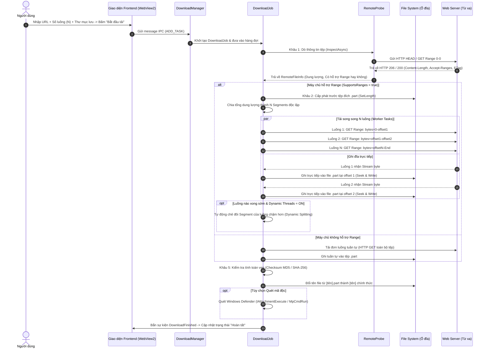
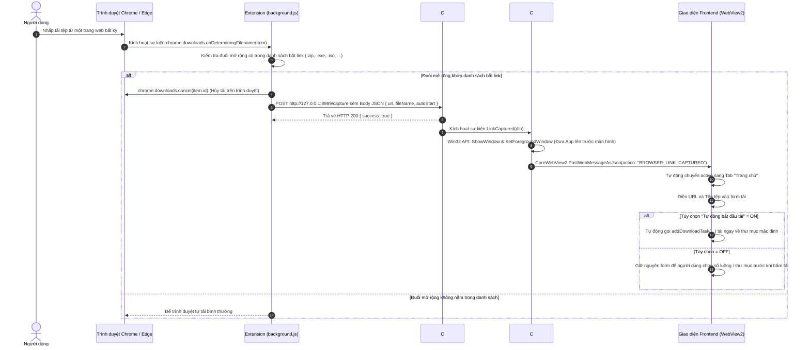
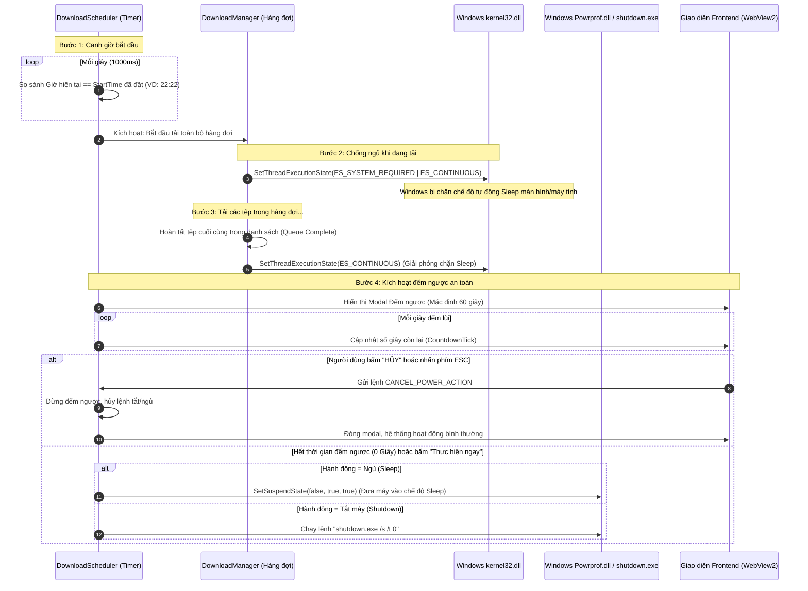

# TÀI LIỆU KIẾN TRÚC & LUỒNG HOẠT ĐỘNG CÁC TÍNH NĂNG CỐT LÕI
### Đề tài PBL4: Ứng dụng Tăng tốc Tải tệp (DUT Download Accelerator)
**Bộ môn: Hệ điều hành & Mạng máy tính**

---

## MỤC LỤC
1. [TỔNG QUAN HỆ THỐNG](#1-tổng-quan-hệ-thống)
2. [TÍNH NĂNG 1: TẢI ĐA LUỒNG MỘT TỆP TIN (FILE DOWNLOAD ACCELERATION)](#2-tính-năng-1-tải-đa-luồng-một-tệp-tin-file-download-acceleration)
   - [2.1 Nguyên lý Cốt lõi & Bản chất Mạng / HĐH](#21-nguyên-lý-cốt-lõi--bản-chất-mạng--hđh)
   - [2.2 Sơ đồ Luồng Hoạt động (Sequence Diagram)](#22-sơ-đồ-luồng-hoạt-động-sequence-diagram)
   - [2.3 Chi tiết Các Giai đoạn Thực thi](#23-chi-tiết-các-giai-đoạn-thực-thi)
   - [2.4 Các Kỹ thuật Chuyên sâu Cần Nắm](#24-các-kỹ-thuật-chuyên-sâu-cần-nắm)
3. [TÍNH NĂNG 2: BẮT LIÊN KẾT TỰ ĐỘNG TỪ TRÌNH DUYỆT (BROWSER EXTENSION INTEGRATION)](#3-tính-năng-2-bắt-liên-kết-tự-động-từ-trình-duyệt-browser-extension-integration)
   - [3.1 Mô hình Kiến trúc & Giao tiếp Liên tiến trình (IPC)](#31-mô-hình-kiến-trúc--giao-tiếp-liên-tiến-trình-ipc)
   - [3.2 Sơ đồ Luồng Bắt Link (Flowchart & Sequence)](#32-sơ-đồ-luồng-bắt-link-flowchart--sequence)
   - [3.3 Chi tiết Cơ chế Kỹ thuật](#33-chi-tiết-cơ-chế-kỹ-thuật)
   - [3.4 Những Điểm Quan trọng Cần Nắm Khi Vấn đáp](#34-những-điểm-quan-trọng-cần-nắm-khi-vấn-đáp)
4. [TÍNH NĂNG 3: LẬP LỊCH TẢI & QUẢN LÝ NGUỒN ĐIỆN WINDOWS (SCHEDULER & POWER MANAGEMENT)](#4-tính-năng-3-lập-lịch-tải--quản-lý-nguồn-điện-windows-scheduler--power-management)
   - [4.1 Nguyên lý Hoạt động & Tương tác Windows API](#41-nguyên-lý-hoạt-động--tương-tác-windows-api)
   - [4.2 Sơ đồ Luồng Lập lịch & Quản lý Nguồn](#42-sơ-đồ-luồng-lập-lịch--quản-lý-nguồn)
   - [4.3 Chi tiết Cơ chế Hoạt động Từng Bước](#43-chi-tiết-cơ-chế-hoạt-động-từng-bước)
   - [4.4 Các Win32 API & Biện pháp An toàn Cốt lõi](#44-các-win32-api--biện-pháp-an-toàn-cốt-lõi)
5. [BẢNG TRA CỨU CÁC KHÁI NIỆM & API PHỤC VỤ BÁO CÁO / BẢO VỆ](#5-bảng-tra-cứu-các-khái-niệm--api-phục-vụ-báo-cáo--bảo-vệ)

---

## 1. TỔNG QUAN HỆ THỐNG

DUT Download Accelerator được xây dựng theo mô hình kiến trúc lai hiện đại:
* **Giao diện người dùng (Frontend):** HTML5, CSS3, Vanilla JavaScript chạy trong môi trường nhúng **Microsoft Edge WebView2** (`Chromium Runtime`).
* **Lõi xử lý & Hệ thống (Backend):** C# (.NET Framework 4.8 / Win32 API) đảm nhiệm quản lý I/O tệp, socket mạng song song, IPC HTTP Loopback Server, tiến trình và tương tác sâu với nhân Windows.
* **Mở rộng trình duyệt (Browser Extension):** Chrome/Edge Extension Manifest V3 tự động nhận diện và chuyển hướng yêu cầu tải về Desktop App.

---

## 2. TÍNH NĂNG 1: TẢI ĐA LUỒNG MỘT TỆP TIN (FILE DOWNLOAD ACCELERATION)

### 2.1 Nguyên lý Cốt lõi & Bản chất Mạng / HĐH
1. **Tại sao tải đa luồng lại nhanh hơn tải thông thường?**
   * **Bản chất Giao thức TCP:** Cơ chế điều khiển tắc nghẽn TCP (Congestion Control) như Slow Start, Congestion Avoidance và giới hạn TCP Window Size khiến một kết nối đơn lẻ (1 connection) không thể tận dụng hết băng thông vật lý của đường truyền, đặc biệt khi máy chủ ở xa (độ trễ RTT cao) hoặc bị server giới hạn băng thông trên từng connection.
   * **Đa kết nối song song (Multi-connection / Parallel Streams):** Bằng cách mở song song $N$ kết nối TCP độc lập (mỗi luồng tải một dải byte `Range: bytes=start-end`), ứng dụng nhân số lượng cửa sổ nhận TCP, tận dụng tối đa băng thông đường truyền và vượt qua giới hạn nghẽn của từng luồng đơn.
2. **Tiêu chuẩn HTTP RFC 7233:**
   * Sử dụng tiêu chuẩn HTTP Range Requests: Máy khách gửi header `Range: bytes=X-Y`, máy chủ có hỗ trợ sẽ phản hồi mã trạng thái `HTTP 206 Partial Content` cùng header `Content-Range: bytes X-Y/Total`.

---

### 2.2 Sơ đồ Luồng Hoạt động (Sequence Diagram)



---

### 2.3 Chi tiết Các Giai đoạn Thực thi

#### Giai đoạn 1: Thăm dò máy chủ từ xa (Remote Probe)
* File thực thi: `WindowsFormsApp/Download/RemoteProbe.cs`
* **Bước 1.1:** Gửi yêu cầu `HTTP HEAD`:
  * Lấy `Content-Length` (kích thước tệp).
  * Kiểm tra `Accept-Ranges: bytes`.
  * Trích xuất `ETag` và `Last-Modified` (để phục vụ xác thực khi Resume sau này).
  * Lấy tên tệp từ header `Content-Disposition: attachment; filename="..."` hoặc từ đường dẫn URL.
* **Bước 1.2 (Cơ chế Dự phòng thông minh):** Nhiều máy chủ hiện đại (Google Drive, Dropbox, CDN) chặn method `HEAD` (trả về 403/405) hoặc cố tình không gửi header `Accept-Ranges`. Ứng dụng sẽ gửi một gói tin `HTTP GET` với header thăm dò:
  ```http
  GET /file.zip HTTP/1.1
  Host: example.com
  Range: bytes=0-0
  ```
  Nếu máy chủ trả về mã **`HTTP 206 Partial Content`** kèm `Content-Range: bytes 0-0/104857600`, ứng dụng khẳng định 100% server hỗ trợ tải chia đoạn, đồng thời thu được tổng dung lượng tệp chuẩn xác (`104857600` bytes).

#### Giai đoạn 2: Cấp phát đĩa trước (Pre-allocation)
* File thực thi: `WindowsFormsApp/Download/DownloadJob.cs`
* **Nguyên lý HĐH:** Khi tải file lớn (ví dụ 4GB) bằng nhiều luồng, nếu ghi tệp theo kiểu ghi đến đâu phình to đến đó, hệ điều hành Windows sẽ liên tục tìm và cấp phát các cluster rải rác trên ổ đĩa, gây ra **phân mảnh tệp tin (File Fragmentation)** nghiêm trọng và làm giảm tuổi thọ ổ SSD/HDD.
* **Kỹ thuật xử lý:** Ứng dụng tạo ngay tệp tạm thời `[filename].part` và gọi API `FileStream.SetLength(totalBytes)`:
  * Hệ điều hành Windows lập tức cấp phát trước một khối dung lượng liên tục trên hệ thống tệp NTFS/FAT32.
  * Giúp phát hiện sớm lỗi **hết dung lượng ổ đĩa (Disk Full)** ngay từ giây đầu tiên thay vì tải được 99% mới báo lỗi.
  * Mở tệp với chế độ chia sẻ `FileShare.ReadWrite`, cho phép $N$ luồng tải ghi đồng thời vào các vị trí offset khác nhau của cùng 1 file mà không bị xung đột (file lock).

#### Giai đoạn 3: Phân đoạn (Segmentation) & Tải đa luồng song song
* File thực thi: `WindowsFormsApp/Download/Segment.cs` & `DownloadJob.cs`
* Giả sử tệp có dung lượng $S$ bytes và người dùng chọn $N$ luồng:
  * Kích thước mỗi đoạn: $\text{ChunkSize} = \lfloor S / N \rfloor$.
  * Đoạn thứ $i$ ($i = 0 \dots N-1$):
    * `StartOffset` = $i \times \text{ChunkSize}$
    * `EndOffset` = $(i == N-1) \; ? \; (S - 1) \; : \; ((i + 1) \times \text{ChunkSize} - 1)$
* Mỗi luồng chạy một `Task` bất đồng bộ:
  1. Tạo `HttpRequestMessage` gửi header: `Range: bytes={CurrentOffset}-{EndOffset}`.
  2. Sử dụng `HttpCompletionOption.ResponseHeadersRead` để nhận Stream dữ liệu ngay lập tức mà không buffer toàn bộ vào RAM.
  3. Đọc dữ liệu từ Network Stream theo từng khối đệm (Buffer 80 KB).
  4. Mở `FileStream`, nhảy con trỏ tới vị trí chính xác:
     ```csharp
     stream.Seek(segment.CurrentOffset, SeekOrigin.Begin);
     await stream.WriteAsync(buffer, 0, bytesRead);
     ```
  5. Cập nhật `CurrentOffset += bytesRead` và bắn sự kiện tiến độ ra UI.

#### Giai đoạn 4: Quản lý Băng thông & Điều tiết tốc độ (Speed Limiter)
* File thực thi: `WindowsFormsApp/Download/SpeedLimiter.cs`
* **Thuật toán Token Bucket (Thùng thẻ bài):**
  * Để giới hạn tốc độ tải (ví dụ: tối đa 2 MB/s), hệ thống không dùng lệnh `Thread.Sleep` bừa bãi gây giật lag luồng.
  * Thuật toán Token Bucket định kỳ rót một lượng "tokens" (tương ứng với số byte được phép đọc) vào một bể chứa chung.
  * Trước khi bất kỳ luồng nào được phép đọc thêm dữ liệu từ socket, nó phải "xin quota" từ Token Bucket:
    ```csharp
    await _limiter.TakeAsync(bytesToRead, cancellationToken);
    ```
  * Nhờ vậy, tổng tốc độ của tất cả $N$ luồng luôn được ghìm chính xác dưới ngưỡng cấu hình của người dùng.

#### Giai đoạn 5: Tạm dừng, Tiếp tục & Phục hồi lỗi (Pause / Resume / Crash Recovery)
* File thực thi: `WindowsFormsApp/Download/DownloadMeta.cs`
* Tiến độ tải của từng Segment (`StartOffset`, `CurrentOffset`, `EndOffset`) được lưu liên tục vào tệp `[filename].meta.json` hoặc Database SQLite.
* Khi người dùng bấm **Pause** hoặc phần mềm bị tắt đột ngột:
  * Khi bấm **Resume**, ứng dụng đọc lại file `.meta.json`.
  * Gửi header kèm điều kiện `If-Range: "{ETag}"` hoặc `If-Range: "{LastModified}"`.
  * Nếu tệp trên server chưa bị thay đổi, server trả về `206 Partial Content` tiếp tục từ đúng byte `CurrentOffset`.
  * Người dùng không bao giờ bị mất dữ liệu đã tải trước đó.

#### Giai đoạn 6: Chia luồng động trong lúc tải (Dynamic Segment Splitting)
* Khi tính năng **"Phân bổ số luồng động"** được bật:
  * Nếu luồng A đã tải xong dải byte của mình nhưng luồng B đang tải một dải byte lớn bị chậm, luồng A không bị giải phóng mà sẽ tự động **cắt đôi phần chưa tải còn lại của luồng B**.
  * Luồng A nhận nửa sau, luồng B giữ nửa trước. Cả hai cùng kéo tiếp dữ liệu về, triệt tiêu hiện tượng "luồng cuối cùng chạy đơn độc kéo dài thời gian hoàn tất".

#### Giai đoạn 7: Hoàn tất & Toàn vẹn dữ liệu
* File thực thi: `WindowsFormsApp/Download/ChecksumHelper.cs` & `AntivirusScanner.cs`
* Khi tất cả các luồng hoàn tất ($100\%$ byte đã ghi):
  1. Đóng toàn bộ các `FileStream`.
  2. Tính mã băm (Hash SHA-256 hoặc MD5) của tệp đích nếu người dùng cung cấp mã băm gốc để đối chiếu.
  3. Đổi tên từ `[filename].part` thành `[filename]` chính thức (`File.Move`).
  4. Xóa tệp metadata `[filename].meta.json`.
  5. Gọi API quét virus của Windows (giao diện COM `IAttachmentExecute` hoặc gọi `MpCmdRun.exe` của Microsoft Defender).
  6. Gửi thông báo Windows Toast Notification cho người dùng.

---

## 3. TÍNH NĂNG 2: BẮT LIÊN KẾT TỰ ĐỘNG TỪ TRÌNH DUYỆT (BROWSER EXTENSION INTEGRATION)

### 3.1 Mô hình Kiến trúc & Giao tiếp Liên tiến trình (IPC)

Trình duyệt web (Google Chrome / Microsoft Edge) chạy trong cơ chế hộp cát bảo mật nghiêm ngặt (Sandbox) và không thể tự ý gọi trực tiếp các hàm thực thi của ứng dụng Desktop C#.

Do đó, hệ thống sử dụng kiến trúc **Local Loopback IPC Web Server**:
* Desktop App mở một máy chủ HTTP lắng nghe riêng trên cổng Loopback nội bộ máy tính: `http://127.0.0.1:8989/`.
* Trình duyệt giao tiếp với Desktop App thông qua các yêu cầu HTTP JSON chuẩn (`POST /capture`, `GET /ping`).
* Giao tiếp hoàn toàn nằm trong bộ nhớ loopback của nhân HĐH Windows (Network Loopback Interface `127.0.0.1`), không truyền qua mạng LAN hay Internet, đảm bảo an toàn tuyệt đối và độ trễ gần như bằng $0\text{ ms}$.

```
┌────────────────────────────────────────┐         HTTP POST JSON         ┌──────────────────────────────────────┐
│  Chrome / Edge Browser                 │  http://127.0.0.1:8989/capture │  DUT Download Accelerator (C# App)   │
│                                        ├───────────────────────────────►│                                      │
│  - background.js (Service Worker MV3)  │                                │  - BrowserExtensionServer (Port 8989)│
│  - chrome.downloads.onDeterminingFilename                               │  - Win32 API: BringToFront           │
│  - chrome.downloads.cancel(downloadId) │◄───────────────────────────────┤  - WebView2: SendToWeb IPC           │
└────────────────────────────────────────┘       HTTP 200 OK Response     └──────────────────┬───────────────────┘
                                                                                             │ BROWSER_LINK_CAPTURED
                                                                                             ▼
                                                                                  ┌──────────────────────┐
                                                                                  │ Frontend UI (HTML/JS)│
                                                                                  │ - Chuyển Tab Home    │
                                                                                  │ - Tự động tải nếu bật│
                                                                                  └──────────────────────┘
```

---

### 3.2 Sơ đồ Luồng Bắt Link (Flowchart & Sequence)



---

### 3.3 Chi tiết Cơ chế Kỹ thuật

#### 1. Tại sao dùng `chrome.downloads.onDeterminingFilename` thay vì `chrome.webRequest`?
* Các trang web tải file hiện đại (Google Drive, Fshare, Mediafire, Download.com.vn) sử dụng link tải tạm thời (Redirect động nhiều lần qua các máy chủ trung gian CDN).
* Nếu bắt link bằng `webRequest`, URL bắt được thường chỉ là trang web redirect đầu tiên, tải về sẽ bị lỗi file HTML rác.
* `chrome.downloads.onDeterminingFilename` là sự kiện của Chrome API kích hoạt **ngay tại khoảnh khắc trình duyệt đã giải quyết xong toàn bộ Redirect**, đã nhận diện được URL tệp tin thực sự ở máy chủ đích cuối cùng và xác định xong tên file chuẩn (`suggestedFilename`).
* Bằng cách gọi `chrome.downloads.cancel(item.id)`, ứng dụng chặn đứng quá trình tải của Chrome trước khi Chrome kịp ghi bất kỳ byte nào vào ổ đĩa, sau đó chuyển toàn bộ URL và tên file sang DUT Accelerator.

#### 2. Cấu trúc Gói tin IPC (`/capture`)
Gói tin JSON gửi qua cổng 8989:
```json
{
  "url": "https://speed.hetzner.de/100MB.bin",
  "fileName": "100MB.bin",
  "autoStart": true,
  "referrer": "https://example.com/download-page",
  "userAgent": "Mozilla/5.0 ...",
  "cookies": "session_id=xyz..."
}
```

#### 3. Win32 API: Đưa ứng dụng lên trên cùng màn hình (Bring-To-Front)
* File thực thi: `WindowsFormsApp/Form1.cs`
* Khi nhận được link tải từ trình duyệt, nếu Desktop App đang thu nhỏ xuống thanh Taskbar hoặc giấu ở khay hệ thống (System Tray), ứng dụng sử dụng các hàm API của Windows User32 để hiện cửa sổ:
  ```csharp
  [DllImport("user32.dll")]
  private static extern bool ShowWindow(IntPtr hWnd, int nCmdShow);

  [DllImport("user32.dll")]
  private static extern bool SetForegroundWindow(IntPtr hWnd);

  [DllImport("user32.dll")]
  private static extern bool BringWindowToTop(IntPtr hWnd);
  ```
* Ứng dụng tự động phóng to về trạng thái `Normal`, đưa cửa sổ lên trên cùng mặt bàn làm việc (Desktop) để người dùng thấy ngay tệp vừa được bắt.

---

### 3.4 Những Điểm Quan trọng Cần Nắm Khi Vấn đáp
1. **Bảo mật CORS của Local Server:** Server HTTP IPC sử dụng header:
   `Access-Control-Allow-Origin: *` và `Access-Control-Allow-Headers: Content-Type`.
   Chỉ lắng nghe trên địa chỉ IP cục bộ `127.0.0.1` (Prefix `http://127.0.0.1:8989/`), không lắng nghe trên `0.0.0.0` hay IP card mạng, ngăn chặn các máy tính khác trong mạng LAN truy cập vào server này.
2. **Kiểm tra trạng thái kết nối (Healthcheck `/ping`):** Extension có nút "Kiểm tra kết nối". Khi bấm, Extension gửi `GET http://127.0.0.1:8989/ping`. Nếu app đang bật, phản hồi trả về `{ status: "ok", app: "DUT Download Accelerator" }` và extension hiển thị chấm xanh "Đã kết nối App".

---

## 4. TÍNH NĂNG 3: LẬP LỊCH TẢI & QUẢN LÝ NGUỒN ĐIỆN WINDOWS (SCHEDULER & POWER MANAGEMENT)

### 4.1 Nguyên lý Hoạt động & Tương tác Windows API
Tính năng này kết hợp 3 tầng công nghệ:
1. **Bộ định thời chạy ngầm (Background Timer):** Lập lịch hẹn giờ tự động bắt đầu tải hàng đợi vào khung giờ vàng (ví dụ: ban đêm từ 22:00 đến 06:00 khi mạng thông thoáng).
2. **Chống ngủ hệ thống (Anti-Sleep Mode):** Tương tác với nhân Windows Kernel (`kernel32.dll`) để giữ máy tính luôn thức suốt thời gian tải, ngăn Windows tự động đưa máy vào trạng thái Sleep/Suspend khi không có người dùng di chuột.
3. **Tự động hành động khi xong (Power Actions):** Tương tác với hệ thống năng lượng Windows (`Powrprof.dll` hoặc `shutdown.exe`) để tự động chuyển máy sang trạng thái Sleep hoặc Tắt máy hoàn toàn ngay khi tải xong toàn bộ danh sách, tiết kiệm điện năng cho người dùng.

---

### 4.2 Sơ đồ Luồng Lập lịch & Quản lý Nguồn



---

### 4.3 Chi tiết Cơ chế Hoạt động Từng Bước

#### Bước 1: Lập lịch giờ bắt đầu tải (Start Time Scheduler)
* File thực thi: `WindowsFormsApp/Download/DownloadScheduler.cs`
* Người dùng cấu hình giờ bắt đầu tải (ví dụ: `23:00`).
* Hệ thống khởi chạy một `System.Threading.Timer` kiểm tra mỗi 1 giây một lần.
* Khi giờ hệ thống chạm mốc `23:00`:
  * Bắn sự kiện `SchedulerTriggered`.
  * `DownloadManager` quét toàn bộ hàng đợi, tự động kích hoạt tất cả các tác vụ đang ở trạng thái `Paused` hoặc `Queued` sang `Downloading`.

#### Bước 2: Chống máy tính vào chế độ Ngủ khi đang tải (Prevent Sleep)
* File thực thi: `WindowsFormsApp/Download/PowerManagementHelper.cs`
* **Vấn đề thực tế:** Khi tải tệp nặng qua đêm, nếu người dùng không chạm vào chuột hay bàn phím, Windows sau 15-30 phút sẽ tự động chuyển sang chế độ Sleep (ngắt kết nối mạng và tắt ổ đĩa), khiến việc tải tệp bị gián đoạn và thất bại.
* **Giải pháp Win32 API:** Ứng dụng gọi trực tiếp API nhân Windows:
  ```csharp
  [DllImport("kernel32.dll", SetLastError = true)]
  private static extern EXECUTION_STATE SetThreadExecutionState(EXECUTION_STATE esFlags);
  ```
  * Khi có ít nhất 1 tác vụ đang tải:
    `SetThreadExecutionState(ES_CONTINUOUS | ES_SYSTEM_REQUIRED)`
    * `ES_CONTINUOUS`: Giữ trạng thái này liên tục cho đến lệnh thông báo tiếp theo.
    * `ES_SYSTEM_REQUIRED`: Thông báo với Windows Power Manager rằng hệ thống đang thực thi tác vụ nền trọng yếu, **ngăn cấm Windows đưa máy vào Sleep/Hibernate** (màn hình vẫn có thể tắt để tiết kiệm điện, nhưng CPU, RAM và Card mạng vẫn duy trì hoạt động 100%).
  * Khi toàn bộ các tác vụ dừng hoặc tải xong:
    `SetThreadExecutionState(ES_CONTINUOUS)`
    * Trả quyền điều khiển nguồn điện về lại cho thiết lập mặc định của Windows.

#### Bước 3: Đếm ngược Cảnh báo An toàn (Safety Countdown Modal)
* File thực thi: `DownloadScheduler.cs`, `index.html`, `script.js`
* Khi toàn bộ hàng đợi hoàn tất, nếu người dùng chọn hành động **Ngủ (Sleep)** hoặc **Tắt máy (Shutdown)**:
  * Không bao giờ tắt máy đột ngột mà luôn kích hoạt bộ đếm ngược an toàn (mặc định 60 giây).
  * Frontend hiển thị Modal cảnh báo nổi bật giữa màn hình với:
    * Đồng hồ đếm ngược số giây to, rõ ràng.
    * Thanh tiến trình chạy lùi trực quan.
    * Biểu tượng động pulsing icon theo từng chế độ (Mặt trăng tím cho Sleep, Nút nguồn đỏ cho Shutdown).
    * Nút **"HỦY TẮT MÁY / HỦY NGỦ (CANCEL)"** màu đỏ viền trắng tương phản cao.
    * Phím tắt **ESC** để hủy bỏ tức thì.

#### Bước 4: Thực thi hành động Nguồn (Execute Power Action)
Nếu hết thời gian đếm ngược mà người dùng không bấm Hủy:
1. **Chế độ Ngủ (Sleep):**
   Gọi hàm Windows API từ thư viện `Powrprof.dll`:
   ```csharp
   [DllImport("Powrprof.dll", SetLastError = true)]
   private static extern bool SetSuspendState(bool hibernate, bool forceCritical, bool disableWakeEvent);

   // hibernate = false: Chế độ Sleep (Suspend to RAM)
   // forceCritical = true: Buộc hệ thống chuyển trạng thái ngay
   // disableWakeEvent = true
   SetSuspendState(false, true, true);
   ```
2. **Chế độ Tắt máy (Shutdown):**
   Gọi tiện ích hệ thống Windows:
   ```csharp
   Process.Start(new ProcessStartInfo
   {
       FileName = "shutdown.exe",
       Arguments = "/s /t 0",
       CreateNoWindow = true,
       UseShellExecute = false
   });
   ```

---

## 5. BẢNG TRA CỨU CÁC KHÁI NIỆM & API PHỤC VỤ BÁO CÁO / BẢO VỆ

| Hạng mục | Khái niệm / API | Bản chất Kỹ thuật & Vai trò trong Đề tài |
| :--- | :--- | :--- |
| **Giao thức Mạng** | `HTTP Range: bytes=X-Y` | Thuộc RFC 7233, cho phép máy khách yêu cầu lấy một dải byte cụ thể của tệp tin thay vì toàn bộ tệp, là nền tảng cốt lõi của tải đa luồng. |
| **Giao thức Mạng** | `HTTP 206 Partial Content` | Mã phản hồi của máy chủ khi chấp nhận yêu cầu tải theo dải Range, đi kèm header `Content-Range: bytes X-Y/Total`. |
| **Giao thức Mạng** | `ETag` & `If-Range` | Định danh phiên bản tệp tin (Entity Tag). Dùng trong Resume tải để đảm bảo tệp trên server không bị sửa đổi trong thời gian tạm dừng. |
| **Hệ thống tệp** | `FileStream.SetLength()` | Win32 File Pre-allocation: Cấp phát trước toàn bộ dung lượng trên ổ đĩa NTFS/FAT32, chống phân mảnh ổ đĩa và kiểm tra dung lượng trống trước khi tải. |
| **Đa luồng** | `Task.WhenAll` / `SemaphoreSlim` | Quản lý đồng thời $N$ luồng tải dữ liệu song song và đồng bộ hóa tiến trình an toàn (Thread Safety). |
| **Điều tiết tốc độ** | `Token Bucket Algorithm` | Thuật toán Thùng thẻ bài điều tiết lượng byte đọc mỗi giây từ socket, duy trì giới hạn tốc độ chính xác. |
| **Giao tiếp IPC** | `HttpListener (Port 8989)` | Local Loopback HTTP Server đóng vai trò cầu nối IPC giữa Chrome Extension và WinForms App, an toàn bảo mật trên `127.0.0.1`. |
| **Trình duyệt** | `chrome.downloads.onDeterminingFilename` | API của Chrome Extension bắt đúng URL cuối cùng sau Redirect và tên tệp chuẩn, hủy tải trên trình duyệt và gửi sang Desktop App. |
| **Windows Win32** | `SetThreadExecutionState` | Hàm trong `kernel32.dll` với cờ `ES_SYSTEM_REQUIRED`, cấm Windows tự động rơi vào chế độ Sleep khi đang có luồng tải tệp. |
| **Windows Win32** | `SetSuspendState` | Hàm trong `Powrprof.dll`, đưa máy tính vào trạng thái Sleep an toàn sau khi hoàn tất tải toàn bộ hàng đợi. |
| **Windows Win32** | `ShowWindow` / `SetForegroundWindow` | Hàm trong `user32.dll`, tự động khôi phục và đưa cửa sổ C# lên hàng đầu màn hình khi bắt được link tải từ trình duyệt. |
| **Bảo mật** | `SHA-256` / `MD5 Checksum` | Băm mật mã học kiểm tra tính toàn vẹn từng bit của tệp tải về so với bản gốc của nhà phát hành. |
| **Bảo mật** | `IAttachmentExecute` | Giao diện COM của Windows Shell tự động quét mã độc với trình diệt virus (Windows Defender) ngay khi file hoàn tất. |

---
*Tài liệu được biên soạn phục vụ công tác nghiên cứu, hoàn thiện báo cáo và bảo vệ đề tài PBL4 (Chuyên ngành Công nghệ Thông tin - Trường Đại học Bách khoa, Đại học Đà Nẵng).*

